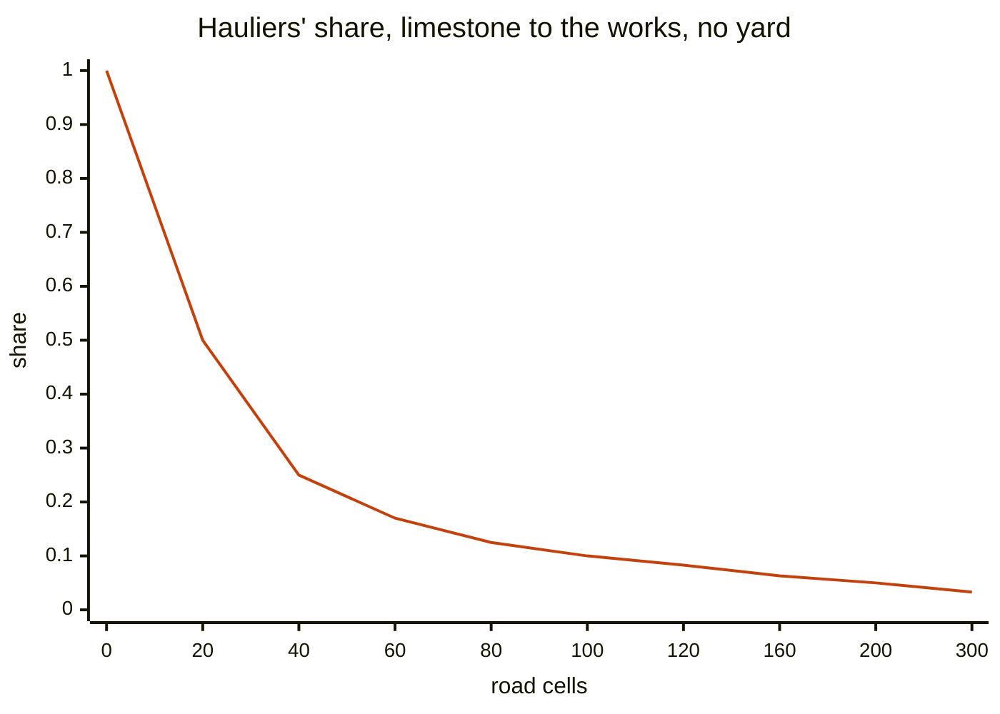
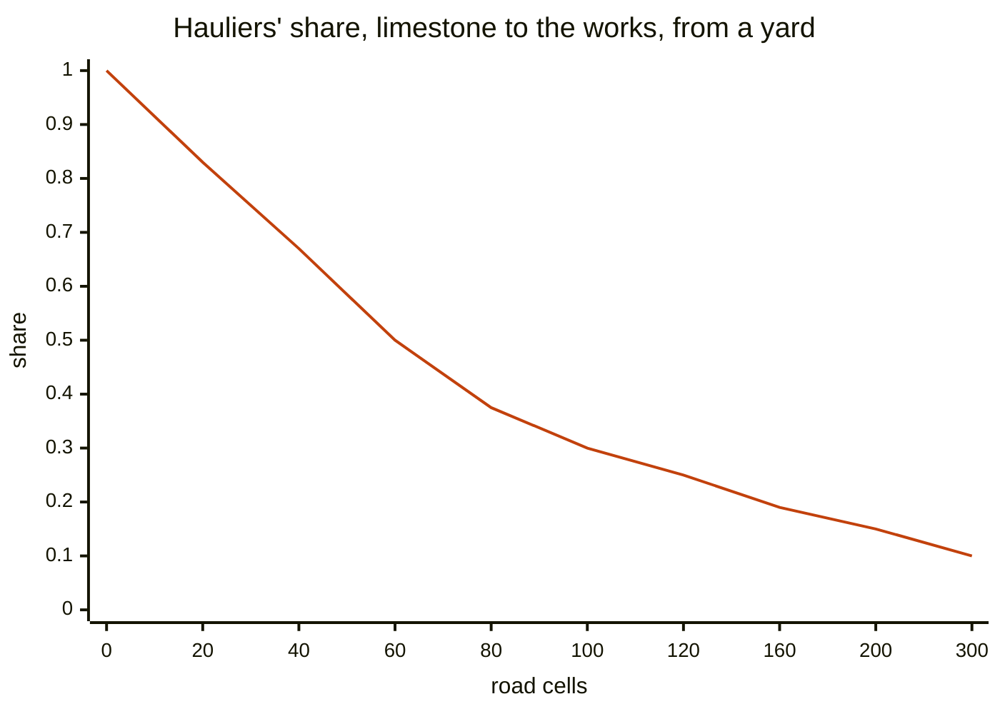
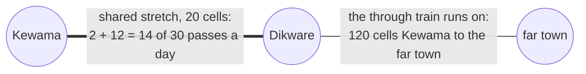
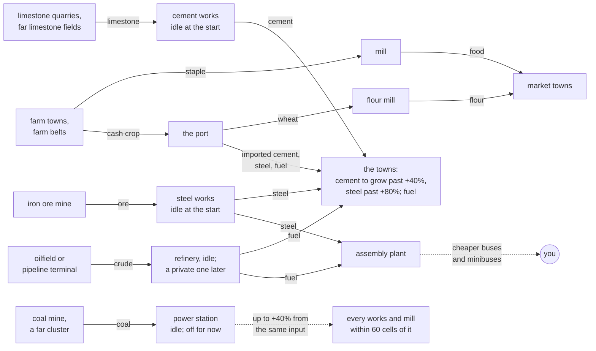
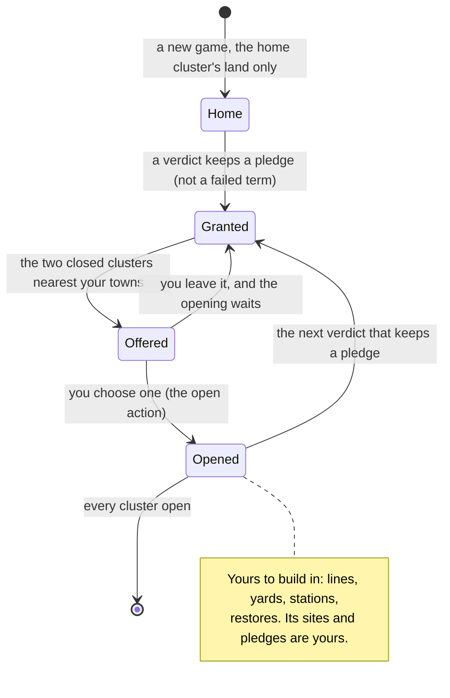
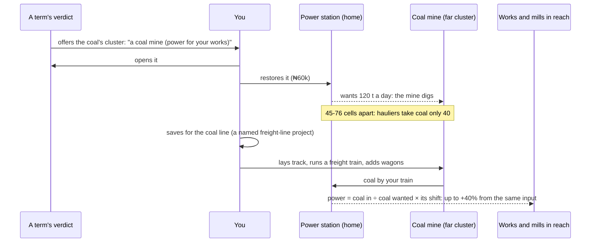

# Engine

Everything under `src/engine/`. Pure TypeScript — no DOM, no three.js, no content
imports (hard rule 1 in [index.md](index.md)). Every submodule here is fully unit
tested; `test/architecture-boundaries.test.ts` enforces the import boundary
automatically, so nothing below needs re-verifying by hand.

## map/ — terrain, nodes, corridors

`generate.ts`'s `generateMap(seed)` is the sole entry point and is **deterministic**:
same seed, same map, asserted in `test/map-determinism.test.ts`. It composes:

- `terrain.ts`'s `generateTerrainField(rng, width, height)` — elevation, water, and
  settlement-density as scalar `Float32Array`/`Uint8Array` fields over a noise field.
  Pure function of the seeded `Rng` (`random.ts`'s `createRng`, mulberry32) — this
  purity is exactly what lets `engine/save` skip serialising terrain and regenerate it
  on load instead (see the save/ section below).
- `nodes.ts`'s `placeNodes(terrain)` — settlement/village/junction placement by density.
- `corridors.ts`'s `generateInheritedNetwork(nodes)` — the brownfield spine: a
  neglected colonial rail line (starts at `condition: 0.6`) and cheap feeder roads
  (`condition: 0.75`) — the brownfield premise ([principles.md](../principles.md) §1)
  rendering itself as a literal number from Module 2 onward.
- `connectivity.ts`'s `assertFullyConnected` — union-find, **hard-asserted** at
  generation end. Every downstream module (routing, scenario seed-fleet placement) leans
  on this guarantee rather than checking it defensively.

**A `Corridor` is a chain of nodes** (`nodeIds: string[]` + one polyline); each
consecutive pair gets its own `Segment` — independently `type` (road/rail), `level`
(underground/ground/elevated), `condition`, `provenance` (inherited/built), and an
optional `profileId` (Module 11b — an opaque key into content's `Profile2DDef`
catalog, never the content type itself). This chain-of-nodes shape is what makes
curves, bridges, stations and elevation fall out of one graph change instead of four
separate features.

`decay.ts`'s `decaySegments(map, dt, eraDecayMultiplier, profileDecayById?)` ticks every
segment's `condition` down each tick, floored at `MIN_CONDITION = 0.3` (friction, not a
route-killing failure state — deferred, see principles.md §4). The two multipliers
**compose** rather than either replacing the other: an Informal-era decay spike still
bites an expressway less than a laterite feeder road, which is the whole point of
authoring the profile difference. `restoreSegmentCondition` is the inverse, used by the
Inspector's maintenance action — always through `pathing/cost.ts`'s `maintenanceCost`
(hard rule 3), and always pricing the deficit actually restored, never a repair that
didn't happen.

`prune.ts`'s `pruneCorridor` is the inverse of authoring's `commitCorridor` and equally
pure (returns a new `GeneratedMap`, never mutates). A settlement or village is never
removed — a place is not built infrastructure and keeps originating demand whether or
not anything currently reaches it (that's what makes "stranded" a real state). Junctions
and vertices go with the corridor that created them, but only once nothing else still
connects to them.

## pathing/ — terrain-aware A*, cost is currency

**The cost function IS the build price** (hard rule 3) — `cost.ts`'s `stepCost` /
`bridgeStepCost` / `sumStepCosts` / `maintenanceCost` are the only functions in the
codebase allowed to turn geometry into currency. `terrainAStar.ts` searches against
exactly these; `plan.ts`'s `planCorridor` produces the same breakdown the live cost
panel and the ghost preview render — one function, three consumers, never two
computations that could disagree.

- **No corner cutting.** A diagonal move whose shared corner is water is disallowed, so
  pathing cost, water measurement, and rendered geometry all agree.
- **`supercover.ts`** walks cells with a DDA algorithm for precise water detection —
  endpoint or interval sampling would miss corner clips.
- **`smoothing.ts`** applies Catmull-Rom to the *entire chain at once*, not per segment,
  to avoid kinks at joins, then clamps the result back to the traversable set (both
  vertices and segments), with a raw-path fallback if clamping would change corridor
  type.
- **Bridges are A\* "jump" edges** — cardinal-only, span-capped (`MAX_BRIDGE_SPAN`),
  and **linearly priced**: total cost still goes with the square since base cost is
  already proportional to span, but the *premium* is linear — exponential would make
  many short spans cheaper than one long one, handing the discount to whoever clicks
  most. The inherited spine gets no span cap (it already exists and wasn't paid for);
  applying the player's cap to it would sever the network.

**Bug caught live, Module 5:** a long ground run between two *separate* water crossings
got misclassified as itself being a bridge, because the jump-distance check compared
only distance without requiring chain-index adjacency (`idx === prevIdx + 1`). Fixed by
requiring that adjacency explicitly.

**Bug caught in the slice, step 3:** `supercover.ts`'s walk, on a line running left or up to
an integer endpoint, tied both crossings at t = 1, stepped past the end cell and wandered
until its guard — off the map, which `isWater` reads as water — so "straight" planning
returned null on dry ground. It now stops once the next crossing is at or past the end
(still taking both corner-adjacent cells at a corner tie). Affects the original game's
straight mode too.

**Known gap (original game):** "straight" mode prices the supercover *staircase* of cells,
not the line — on flat ground a straight road quotes ~2.5× the identical auto road. The
slice prices straight lines itself (`roads.ts` `planDirect`, below) rather than change the
original game's balance.

## simulation/ — the tick loop

`simulate.ts`'s `tick()` is the one integration point that threads economy, paratransit,
era modifiers, growth and profile decay together (see [index.md](index.md)'s tick-loop
section for the call signature). In order, each tick:

1. `demand.ts`'s pre-generated `DemandPair[]` (reciprocal passengers between every
   inhabited node pair, one-way goods village↔nearest-settlement) grow each node's
   `NodeQueues` — aggregate `(destination, kind) -> amount`, never per-passenger agents
   (hard rule 4). Demand pairs are static topology; growth (see below) scales the
   *rate* a pair generates, never the graph itself.
2. `map/decay.ts` decays segment condition.
3. `congestion.ts` computes the tick's **one published load per segment**:
   `computeSegmentLoads` (vehicles, weighted by `congestionWeight` — an okada isn't a
   bus) plus `computeAmbientLoads` (private cars, see below), summed via `addLoads` into
   `SimulationState.segmentLoads`. Everything that needs "how loaded is this road" reads
   this single number — vehicle speed, the paratransit spawn check, the Corridor stress
   overlay — never recomputes it. Congestion **scales effective capacity, not just
   speed** (speed-only would mean more vehicles is always strictly better), floors at a
   minimum factor, and gives a **free first slot** (one vehicle on a corridor is not
   congested).
4. `vehicle.ts`'s `tickVehicle` moves every vehicle along its path, loading
   opportunistically at each node (queued demand whose destination lies ahead on the
   remaining route — no manifests) and unloading on arrival, gated by
   `isCompatibleCargo` (a goods vehicle never loads passenger demand). **Player vehicles
   are `cyclic`** (loop forever); **paratransit vehicles are `one-shot`** (removed on
   `hasCompletedTrip`) — cyclic paratransit was measured to drain queues to a
   comfortable equilibrium and remove the pressure to build, which is why the
   distinction is load-bearing, not cosmetic.
5. Economy and paratransit react to what the tick just did (see their own sections
   below).
6. Growth samples this tick's pickups and may return `PromotionEvent[]`.

### Ambient private traffic (Module 12)

`congestion.ts`'s `computeAmbientGeometry`/`computeAmbientLoads`: **no car agents** —
prosperity (growth's `D`, see below) times the era's `ambientTraffic` content field
becomes a per-segment load, the same "aggregate number, not entities" reasoning as
queued demand. `SimulationState.ambientLoads` publishes the private-car share
separately from the combined `segmentLoads`, so the renderer draws cars *from* a number
without ever inventing traffic nobody is driving.

**Attenuation is measured from each segment's midpoint, not its endpoints — and that
distinction is the whole mechanic.** Measured at the endpoints, a long
settlement-to-settlement highway has both ends at distance zero and would carry full
traffic along its entire length: prosperity would degrade every road uniformly, a flat
tax with nothing to route around. Measured at the midpoint, short approaches stay busy
and the open middle of a long intercity run stays clear. Caught by looking at the first
render, not by a test.

**Rail's immunity is structural, not a filter** — rail segments are excluded when the
ambient geometry is built, so there is no code path in which a railway acquires car
traffic. This is deliberate: if rail took even a fraction, there would be no
infrastructure immune to the late-game hazard, and the mechanic would stop being a
decision. Ambient traffic closes a real vicious loop (cars slow buses → queues clear
slower → unserved EMA rises → paratransit spawns → paratransit adds *more* load) — see
the paratransit section below for the damping that keeps it a decision rather than a
death spiral. Numbers (`ambientTraffic: 0.02/0.18/0.08/0.38` across the four eras) are
starting points, not calibrated — see principles.md §5's open questions.

### `rebuildFromMap`

Everything derived from map topology — `routing` (A* graph) and `ambientGeometry` — is
rebuilt together in one function, `simulate.ts`'s `rebuildFromMap(state, map)`. Callers
used to set `routing` by hand at two separate call sites in `render/fleet.ts`; adding a
second derived cache to that pattern would have meant two places to forget one. A stale
`ambientGeometry` is the quiet kind of wrong — traffic would keep clustering around a
settlement that's since been pruned away from.

## economy/ — funds, fares, obsolescence

`state.ts`: **revenue accrues on unload** (`recordDeliveryRevenue`), never on carriage.
**Operating cost is per-tick and unconditional** (`applyOperatingCosts`) — it applies
even at negative funds; debt is allowed, with no interest and no game over (a hard
failure is wrong for a sandbox, principles.md §3). Depreciated resale
(`sellVehicle`) floors at `MIN_RESALE_FRACTION` rather than going to zero, or a player
in debt liquidates the fleet and is instantly solvent.

**Graceful obsolescence, not despawn.** A vehicle def's `eraOut` closes the purchase
catalog without touching owned stock — `markVehicleObsolete` (idempotent; an era
timeline only moves forward) is called once an owned vehicle's def falls outside the
current era's window, and `applyOperatingCosts` ramps its maintenance 2%/sec obsolete,
capped at 3×. Rising, so staying obsolete is a real cost, but capped so it's never an
unrecoverable death spiral for one vehicle.

**EMAs updated exactly once per tick, globally** (`incomeRateEMA`/`costRateEMA`) —
`updateIncomeRateEMA` takes the tick's *total* revenue across every vehicle, not a
per-vehicle call.

**Bug self-caught before shipping, Module 6:** the original plan was to update
`incomeRateEMA` *inside* the per-vehicle delivery-revenue function. That would decay the
rate toward zero on every vehicle that didn't happen to deliver on that specific tick,
compounding with fleet size. Split into a per-vehicle ledger-only update
(`recordDeliveryRevenue`, no EMA touch) and one once-per-tick
`updateIncomeRateEMA(state, totalRevenueThisTick, dt)` — this is the canonical example
behind hard rule 7.

**Bug caught live, Module 7 (90s untouched run):** `simulate.ts`'s `tick()` originally
credited *any* vehicle's delivery to the player's economy, including paratransit's —
player funds rose from ₦1,000 to over ₦5,000 purely from informal traffic nobody bought.
None of the 125 tests running at the time caught it, since none checked player funds
with paratransit running concurrently. Fixed by gating the credit on
`vehicle.lifecycle !== "one-shot"` — paratransit is an independent informal economy, and
that gate (not "does economy have an entry for this vehicle id") is what keeps it
correct even if the entry-based invariant ever slips.

## paratransit/ — the informal antagonist

`spawn.ts`'s `trySpawnParatransit`: one-shot vehicles spawn on **sustained** unserved
demand — a rolling EMA per demand pair (`pairUnservedEMA`), never queue depth alone. A
real operator does not join a jam that pays nothing. Capped **per corridor as well as
per demand pair** — many pairs route over one shared corridor, and without a
corridor-level cap 20+ informal vehicles were measured accumulating on one link,
collapsing throughput to ~10%. Spawning is **passengers-only** (informal freight needs
capital an okada doesn't have) and **damped, not blocked**, by the rolling
player-served share (`growth`'s `playerServiceEMA`) for that origin — a hard cutoff at
moderate service would turn the antagonist into a subsystem that politely waits its
turn, which is exactly the failure mode principles.md's hook section warns against.
Informal-era pressure is strong enough to break through service that would block a
spawn in a calmer era — that's the correct reading of "rail collapse, paratransit
takeover," not a bug (a test asserting the two "compose" nicely was itself wrong, and
was fixed to match).

## eras/ — the compressed timeline

> **Retired 2026-10-23 with the 3D game** (calendar eras and save/scenarios). Kept as history; the code is under the git tag `original-3d`. See [index.md](index.md).

`timeline.ts`: `createEraTimeline`/`advanceEraTimeline`/`currentEra`. Four eras
(Post-Independence → Oil Boom → Informal → Modern) advance on **real elapsed time**, not
player action, and hold at the final era rather than looping. `advanceEraTimeline`
returns an `EraTransition | null`, consumed by `main.ts` to react (palette, obsolescence
marking, rail-gating reconciliation, a banner) and by `window.dev.era()` to synthesize
one manually (see [dev-studio.md](dev-studio.md)).

**Five modifiers thread through `tick()` as `EraModifiers`**, a plain engine-side type
with no `palette` field (palette is render-only — hard rule 2): `demand`, `fuel`,
`buildCost`, `decay`, `paratransitPressure`, and `ambientTraffic` (Module 12, required
rather than optional-with-a-default — an era that forgot to say how motorised it is
would silently render as empty roads, and a missing mechanic that looks like a working
one is the worst kind). Each submodule takes its multiplier as a bare number, never the
`EraModifiers` type itself — `simulate.ts` is the only place in `engine/` that knows
eras exist at all.

**Rail goes dark through Informal, returns as standard gauge in Modern** —
`EraDef.railAvailable`. A designed absence must be visible in advance (a catalog
timeline shows it coming), not ambush an in-progress build — see
[render-and-ui.md](render-and-ui.md) for how authoring reconciles a mid-draw rail
selection if a transition happens while the player is mid-draw.

## growth/ — logistic demand growth, service ratio, promotion

`state.ts`: each village/settlement node gets a `NodeGrowthState` with a demand
multiplier `D` (starts at `INITIAL_DEMAND_MULTIPLIER = 1`) that grows via a logistic ODE
— `dD/dt = growthRate * D * (1 - D/D_max)` — bounded by a per-tier `D_max` (village:
2.5, settlement: 6; independent constants, **not derived from `D` itself**, or the
logistic cap would chase the variable and growth would be uncapped exponential wearing a
logistic's clothing). `D` feeds back into `simulate.ts`'s `growQueues` as a per-origin
multiplier on `pair.rate` — growth scales the *rate*, demand pair topology never
changes.

`growthRate` is gated by a smoothstep on a rolling, paratransit-discounted service ratio
S̄ (`serviceRatioEMA = playerServiceEMA + PARATRANSIT_SERVICE_DISCOUNT *
paratransitServiceEMA`, discount ~0.5 — paratransit *sustains*, player service
*develops*). **`playerServiceEMA` is a necessary condition, not a weighted
contributor** — growth is gated to exactly zero below `PLAYER_SERVICE_EPSILON = 0.02`
regardless of how high paratransit's discounted contribution pushes the combined ratio,
or reachability would saturate late-game and everything would grow on informal service
alone.

**Bug caught by a live integration test, not synthetic ones (Module 9).** The first
implementation EMA'd the *per-tick clamped ratio*
(`clamp01(servedThisTick / generatedThisTick)`), which looked fine against synthetic
100%-every-tick samples but failed against real vehicle behavior: a vehicle visiting a
node every few seconds delivers service in a burst that dwarfs that single tick's tiny
generated amount, so clamping to `[0,1]` before averaging threw away nearly all of the
burst's weight — `playerServiceEMA` stuck around 0.01–0.015 forever, below the 0.02 gate,
no matter how well the route was actually served. Fixed by EMA-ing the **raw rates**
independently (`generatedRateEMA`, `playerServedRateEMA`, `paratransitServedRateEMA`,
each `amount/dt`) and taking the ratio of the smoothed rates afterward — never smoothing
an already-computed ratio. This is the second instance behind hard rule 7.

**A second bug, also caught by testing before it shipped.** The promotion threshold was
originally `D_MAX.village * PROMOTION_THRESHOLD_FRACTION` = `2.5 * 0.3 = 0.75` — *below*
the starting multiplier of `1`, so every village promoted to settlement on its very
first tick regardless of service. Fixed by measuring the threshold as a fraction of the
*growable range above the starting multiplier*: `1 + 0.3 * (2.5 - 1) = 1.45`, which is
safe by construction for any fraction below 1.

**Promotion is a `NodeKind` mutation, nothing more elaborate** — `village` is already
the top of a two-level hierarchy below `settlement`, so `GrowableTier` just mirrors
`NodeKind` rather than inventing a parallel enum. `applyPromotion` mutates
`GeneratedMap.nodes[i].kind` **in place** (same pattern as `decaySegments` mutating
`Segment.condition`), which is what makes the promotion show up as a real map change for
free once the caller re-renders from that same map — see
[render-and-ui.md](render-and-ui.md) for the visual side.

**A gap Module 11 closed:** `congestionWeight` had been modelled in `congestion.ts`
since Module 7, but nothing ever supplied a value — every player vehicle used
`createVehicle`'s default of 1, so an okada weighed exactly as much as a BRT, the exact
thing principles.md's paratransit findings warn against. The vehicle catalog now carries
real weights (content, see [content.md](content.md)); `render/fleet.ts` threads them.

## save/ — versioned snapshot and scenarios (Module 10)

> **Retired 2026-10-23 with the 3D game** (calendar eras and save/scenarios). Kept as history; the code is under the git tag `original-3d`. See [index.md](index.md).

`types.ts`/`snapshot.ts`: `createSnapshot`/`restoreIntoState` mutate the target
`simulation`/`economy`/`paratransit`/`growth`/`eraTimeline` objects **in place** (same
pattern as `applyPromotion`/`decaySegments`) rather than returning new ones —
`main.ts`'s controllers hold direct references to these objects, so replacing them
would leave those controllers pointed at stale state.

**A save is state, not content.** `SaveFile` is a hand-written type, not derived from
`content/schema.ts`. The content schemas' `.default()` calls
(`congestionWeight.default(1)`, `channels.default({})` — see [content.md](content.md))
are correct for a hand-authored catalog, where an absent field means "assume the common
case." They are wrong for a save, where an absent field means "this save predates it"
and must fail the version check, not silently backfill a plausible value.
`restoreIntoState` rejects anything whose `version` doesn't match
`SAVE_FORMAT_VERSION` exactly, with a clear error, and leaves the target state
untouched on rejection.

**Terrain is the only thing derivable from the seed.** `generateMap` is deterministic
(see map/ above), so `SaveFile.map` stores `{ seed, nodes, corridors, segments }` and
`restoreIntoState` regenerates the ~7k terrain floats via `generateTerrainField` rather
than serialising them. Everything else in that shape has drifted from what the seed
alone would produce and must be stored: promoted `node.kind`, decayed
`segment.condition`, authored corridors/segments, and — the field that would corrupt a
save *silently*, since a dropped one still renders fine off the inherited-profile
fallback — **`segment.profileId`**. `SimulationState`'s four fields derived from map
topology (`demand`, `routing`, `ambientGeometry`, `segmentLoads`/`ambientLoads`) are
never serialised either — `restoreIntoState` calls `rebuildFromMap` and
`generateDemandPairs` instead of storing a second source of truth for something the
engine already recomputes.

`scenario.ts`: `applyScenario`/`warmForward` take plain mirrored types
(`ScenarioSpec`/`ScenarioVehicleSpec`), never `Scenario` or `VehicleDef` directly — hard
rule 2, same pattern as `EraDef`. `applyScenario` sets funds and jumps the era timeline
directly (not via `advanceEraTimeline`, which only ever moves forward), then places
`seedFleet` vehicles round-robin over pairs of inhabited nodes on the map's
already-connected inherited network — no corridor authoring needed, since `generateMap`
guarantees full connectivity. Seed vehicles are registered as real purchases (funds
deducted, ledger entries created), not free stock: `startingFunds` and `seedFleet` are
both scenario-author knobs, shown side by side in the Scenario Lab, so the author
reconciles them directly.

**`warmForward` runs real ticks, not a clock skip**, so a warmed scenario produces an
economy, a paratransit sector, and grown settlements that actually exist for the target
era — reproducible from the same seed, since nothing in the tick path but paratransit's
spawn-id derivation uses randomness, and that derives from `paratransit.elapsedSeconds`
(deterministic; there is no `Math.random` anywhere under `src/engine/`). Its
`growth`/`eraModifiersById`/`profileDecayById` parameters are **required**, unlike
`tick()`'s optional ones: `tick()`'s parameters are optional so existing call sites keep
compiling, but a warm-forward that omits `eraModifiers` gets no ambient traffic at all,
omits `growth` and settlements never develop, omits `profileDecayById` and every segment
decays at the base rate regardless of profile — a warm-forward missing any of them would
warm the wrong world *silently*. Making them required at `warmForward`'s own boundary
turns that into a compile error instead of a silent gap.

*Known limitation, not a blocker:* a warmed-forward vehicle's obsolescence isn't marked
mid-warm (that logic lives in `render/fleet.ts`'s `markObsoleteStock`, which needs the
content catalog `engine/` can't import). `main.ts` calls
`fleetController.handleEraChanged()` once after a scenario/save is applied, which
catches it for the *final* era reached, just not for eras passed through en route.

## game/ — the game (was slice/, the reset's loop: principles.md §6)

`engine/game/` composes existing modules into the slice's tick rather than extending
`simulation/simulate.ts`'s `tick`. Two hooks in `simulation/` exist for it: `tickVehicle`
takes an optional `Loader` that replaces the default boarding rule at each stop, and
`LoadEntry` carries an optional `trip` (origin, final destination) that `DeliveryEvent`
hands back on unload. `nodesAhead` is exported and shared. It reuses `createVehicle` / `createOneShotVehicle` /
`tickVehicle`, `buildRoutingContext` / `findPath` / `rebuildFromMap`, and economy's
purchase, sale, operating-cost and income-EMA functions unchanged. It does not use eras,
growth, decay, ambient traffic, or `paratransit/spawn.ts`.

- **`world.ts`** — `createGameWorld(def, tuning)` builds a `GeneratedMap` (blank terrain,
  every town a `settlement`, inherited roads as two-point corridors) and replaces the
  generated demand with **gravity demand** (`k · popA · popB / distance`, passengers only,
  reciprocal, between *every* pair whether or not a road joins them). Player actions —
  `buildRoad`, `addBus`, `removeBus` — return `{ ok, reason }` and each has a matching
  `check*` the UI uses for previews. `roadCost` is the only function that prices a road
  (hard rule 3). Road paths are cached per pair in `pathCache`, cleared on every road change.
- **`tick.ts`** — `gameTick`, in order: arrivals; **giving up** (each queue loses
  `1 − e^(−dt/patience)` per tick into a motor-park pool, so a queue settles at
  rate × patience — no `QUEUE_CAP`); vehicle movement and fares; **danfo dispatch**; reap;
  operating cost; rolling rates; settlements. Every waiting rider remembers the trip
  they're on: queue keys are `destination|origin`, pool keys `at>origin>destination`, so a
  rider changing buses or giving up at an interchange is still counted against their
  original trip.
- **Transfers** (`transfers.ts`) — `buildTripPlans` does a breadth-first search over
  routes per destination: a stop is *k* buses away if some route through it reaches a stop
  *k − 1* away. For each (stop, destination, route) on a fewest-buses trip it records where
  to get off — the qualifying stop nearest the destination. The slice's bus `Loader` boards
  riders whose planned stop is in `nodesAhead`; on unload, a rider short of their
  destination goes back into that stop's queue (same trip key) and counts toward its
  interchange rate. Each leg pays a fare on getting off. Danfos' `Loader` takes anyone whose
  final destination is ahead. The plan is cached on `world.plans`, nulled whenever a route
  is created or removed, a town is founded (paths change) or abandoned.
- **The informal sector** (`dispatchInformal`) — two motor-park pools with the same keys.
  Stage 1, `pool`: people who gave up on your bus wait for a danfo. Riders are grouped by
  where they are and their first hop; a danfo (14 seats) goes toward the destination whose
  path collects the most of them and takes everyone whose stop is on the way, if that's a
  full load. Riders who won't wait any longer drift (τ = patience × 3) into stage 2,
  `smallPool`: a keke (3 seats) goes when 3 share a run, otherwise an okada takes one rider.
  Stage-2 riders who out-wait even that go home. With no road, pooled riders go home at
  once. Every informal vehicle is created with an *empty* queue map — it leaves with the
  people who gave up, not the queue still waiting for you — but its `Loader` picks up
  anyone at a stop it passes whose final destination is ahead, which counts as `poached`.
  **Road space** caps the sector per segment in danfo-equivalents
  (`informalRoadSpace`, each mode's congestion weight: danfo 1, keke 0.5, okada 0.3);
  `informal.active` records each vehicle's mode, weight, segments and how many it has
  `released`: `reapInformal` gives back each segment once the vehicle is past it (it's on
  segment `pathIndex - 1`) and the rest when the trip ends. Holding the whole path until
  the end let a long run keep trunk space it had left, and a new long road lowered trips
  made (brief step 5b). A roadside town splitting a segment behind a vehicle shifts its
  `released` count (settlement.ts). The budget is the road's, not the sector's:
  `dispatchInformal` adds the road space your vehicles are using on each segment now
  (from `vehicleSegment`) to what informal vehicles hold before checking the cap. The cap
  itself is by surface: `informalBudget(world, segmentId)` is `informalRoadSpaceDirt` (9)
  on an inherited dirt road, `informalRoadSpace` (15) on a paved or built one, so paving
  lets more danfos run (step 7's tolls collect from them). Capacities, speeds and weights come from the original catalog
  (`public/content/vehicles.json`).
- **Outcomes** — kept per (origin, destination) pair in `world.pairOutcomes`, as EMA rates
  (τ = one game day) of four disjoint buckets, each counted once, *when the trip
  resolves*: `player` (arrived at their destination on your buses, however many changes),
  `poached` (a passing danfo picked them up from a stop), `gaveUp` (waited too long, then
  left on a danfo), `lost` (stayed home). Danfo share is poached + gaveUp; they're kept apart because
  they answer different questions about a losing route. Town and network shares
  (`townShare`, `networkShare`) and the desire lines (`tripsFrom`) are all sums over pairs
  — one source, no per-town copy to drift. Attribution needs each pickup's destination and
  vehicle, so `simulation/types.ts`'s `PickupEvent` carries `to` and `vehicleId`.
- **Routes** keep EMAs of fare income, boardings, and load factor (mean cargo/capacity of
  their buses). Route cost is buses × operating cost.
- **`diagnoseRoute`** — measured, not modelled: sums the outcomes of trips whose planned
  journey rides this route for at least one leg (`plannedRoutes`) — so a feeder's numbers
  include the riders it hands on — then picks one verdict, most structural first: `thin` (one bus,
  catching about `ONE_BUS_REACH` — half — of every possible rider, wouldn't pay its running
  cost; measured, one bus catches ~33–55%), `overcapacity` (≥2 buses, load < 35% *and*
  ≥ 60% of riders already carried), `full` (load ≥ 85%), `poached` (≥ 20% taken by passing
  danfos), `waiting` (≥ 30% gave up), else `healthy`. The page turns the verdict into a
  sentence; the engine never formats text.
- **Towns along busy roads** (`settlement.ts`) — each segment keeps EMAs of riders/second
  passing a point (all vehicles, and yours alone). Once a game day: an emergent town below
  `abandonBelowPopulation` is abandoned, then at most one town is founded — at the midpoint
  of the busiest segment that's at least `2 × townSpacingCells` long, clear of every node by
  the spacing, with total flow ≥ `foundTownFlow` *and* your flow ≥ `foundTownPlayerFlow`
  (your service is a necessary condition — principles §3, Growth). Founding **splits the
  segment** into two through the new node (a corridor is a chain of nodes), and
  `insertIntoPath` threads the town into every vehicle path crossing it, keeping each
  vehicle where it physically is — so a bus route on that road serves the new town at once.
  The halves are too short to found on again, which is what keeps towns sparse; 
  `maxEmergentTowns` is the backstop. Emergent populations drift (τ = 10 days) toward
  `riders/s through it × populationPerFlow`; demand is regenerated once a day.
  Abandoning turns the node into a `junction` (the road keeps its bend), moves the town to
  `world.ruins` so its name stays on the map, and drops its queues, pools, demand and
  outcomes. Original towns never change size and never fade. `gameTick` returns these as
  `GameEvent`s.
- **Bus placement** — `addBus` creates the vehicle without queues (no teleport-load) and
  places it at the midpoint of the largest gap between the route's existing buses
  (`cycleFraction` / `largestGapMidpoint`).
- **Congestion** (`congestion.ts`) — `updateRoadSpeeds` runs once per tick before anything
  moves. It detects road space *entering* each segment (a vehicle starting a new leg —
  keyed `segment#pathIndex`, so a shuttle re-enters its one segment each way), keeps a
  rolling flow per road (τ = 10 s), and sets `world.segmentSpeed` from the BPR curve,
  `1 / (1 + 0.15·(flow/capacity)^4)`, floored at `minSpeedFactor`. Capacity is per road:
  `roadFlowCapacity`, × `dirtRoadCapacity` for inherited roads. `tickVehicle` takes those
  speeds through its `speedFactors` hook, so the number that slows a bus is the number the
  map draws. Road space is each vehicle's congestion weight (bus 1.2, danfo 1, keke 0.5,
  okada 0.3). Informal operators won't dispatch onto a road below `informalMinSpeed`.
  Routes keep a speed EMA; `diagnoseRoute` adds `speed`, `informalTraffic` (informal share of
  the road space on its roads now) and the `jammed` verdict (speed < 70%), ranked after
  `thin` and `overcapacity`. A segment split carries its flow to both halves.
- **Paving** (`paveRoad` / `checkPave` in `world.ts`, `isDirt` in `congestion.ts`) — turns the
  one dirt segment directly joining two towns (`directRoad`) into a built one, at `paveCost`
  (surface only since step 3; on flat ground what building it would cost). Provenance is the surface in
  the slice, so `splitSegment`'s copy leaves both halves of a paved road paved and the map
  draws it like a built road. `dirtRoadsOn(route)` lists a route's dirt roads for the
  jammed reason.
- **Inside towns** (`localTravel` in `world.ts`) — display only: a town's inside trips
  (`population × localTripsPerThousandPerDay`), the share of your riders who reach the park
  by keke or okada (`pop / (pop + walkableTownPopulation)`), and that share of your riders
  starting or ending trips there (`pairOutcomes`, so riders changing buses aren't counted).
  Nothing in the tick reads it; it touches no share and no money (a test pins that).
- **The seeded variation** (Revision 1, step 3; `variation.ts`) — `variedGameMap(base, seed)`
  returns a copy of the hand-made map with town sizes drawn (Ilase ×0.85-1.2 and always the
  largest; a town no inherited road reaches ×1/3-3, every other town ×0.5-2, log-uniform, capped at 70% of Ilase) and the river's course
  and widths drawn (interior points shifted up to 5 cells; widths 2.5-5 cells at each point,
  one ford of 1.2). Bridges are paid by the water cell, so where the ford lands decides which
  crossing a road takes. A drawn river that puts water within 2 cells of a town, or a town on
  the other bank, is drawn again. Seed 0 returns the authored map unchanged: earlier
  measurements were taken on it, and probes and tests default to it. The page reads `?seed=N`,
  or draws one and writes it into the address so a reload replays the map ("Map N · New map"
  on the controls line). The bots take `SEED=`. Superseded on the page and in the bots by
  generated maps (below); kept for its `varyTownSizes`, which they share.
- **Generated maps** (R1 7; `generate.ts`) — `generatedGameMap(base, seed)` (and
  `generatedMapInfo`, which also names the setting, the trunk and the draws rejected): seed 0
  is the hand-made map; any other seed draws, on the hand-made map's 100×64:
  - the dominant city's **setting** (coast, river or inland, once per seed) and bank, then the
    city (coast: by a sea along its bank's edge, drawn as a very wide river off the map;
    river: within 9 cells of the river; inland: 15+ from the river and the edge);
  - a **river** from the top of the map to the bottom (x 38-62, meandering ±6, widths 2.5-5,
    one ford of 1.2);
  - eight more towns by **spacing** (15 cells apart, 6 from the edge, 3 from water; engine/map
    `nodes.ts`'s rule), at least 3 on each bank;
  - the **trunk**: the city, a middle town on its bank, the second city across the river, each
    leg within 25% of the hand-made one's (25.5 and 38.1 cells) and running on, not back; the
    hand-made sizes go to the trunk (120, 45, 70) and the rest shuffled, then varied by
    `varyTownSizes` as the variation does (a draw where the city stops being the largest is
    rejected);
  - 2-3 **cut-off** towns off the trunk, and **spurs** joining the rest, shortest first, on
    their own bank (only the trunk crosses the river), clear of other towns and of other roads;
  - one **ridge** (two hills) on the line from the cut-off town with the widest gap to its
    nearest joined town, a full radius clear of every town;
  - the **old railway**, straight from the city to the farthest town across the river (not the
    second city), clear of towns; the city is the port.
  A guard failing rejects the draw and the next is drawn from the same stream (deterministic);
  the last guard is reachability -- engine/map's `UnionFind` over the inherited roads and every
  road `planCorridor` can plan from a town to its three nearest. 2,000 seeds: none falls back
  (after 400 draws, to the variation), the slowest 102 ms. Town names come from a pool none of
  the hand-made map's names are in. The corridor probe takes `SEED=` too, its corridor
  defaulting to the trunk's first leg.
- **Terrain and roads** (step 3; `terrain.ts`, `roads.ts`) — `buildGameTerrain` turns the map
  def's authored rivers (centre line + width, or a width per point that varies between them) and hills (smooth bumps; elevation unbounded,
  since water is explicit) into the same `TerrainField` engine/map makes, and hard-fails a
  town in water. `planRoad` runs `pathing/plan.ts`'s `planCorridor` in auto mode (terrain A*,
  bridges as jump edges, smoothing) — or, for `alignment: "direct"`, `planDirect`: water by
  supercover, one span-capped bridge per crossing, ground priced by stepping the true line
  through `stepCost` — and "cheapest" takes whichever of the two costs less. It converts the
  `CostBreakdown` at one exchange rate,
  `roadCostPerCell / BASE_COST_PER_CELL`, naming the bridge and hills parts; plans are
  cached per pair (terrain never changes). A built road stores the plan's polyline on its
  corridor and its arc length on `Segment.length`, which routing and `tickVehicle` read
  (`nodeDistance` uses the edge weight), so a bend is a longer trip. Inherited roads stay
  straight with no `length` (brownfield premise). Paving prices the surface only:
  `segmentLength × roadCostPerCell`. A roadside town is founded halfway along the road's
  arc, never over water, and `splitSegment` splits the polyline there.
- **Wear** (step 4, `wear.ts`) — `updateRoadWear` runs each tick after the vehicles move:
  every segment loses `(weatherPerSecond + wearPerFlow × roadFlowEMA) × dirt × bridge` per
  second, floored at `map/decay.ts`'s `MIN_CONDITION`; maintained segments
  (`world.maintained`) are held where they are and the wear is billed via `repairCost`,
  which prices ground cells with `pathing/cost.ts`'s `maintenanceCost` and bridge cells
  (`bridgeCellsOn`, cached) at 4× (the build ratio), × `repairCostScale` at the slice's
  exchange rate. The tick charges that through `applyOperatingCosts`'s new
  `otherCostThisTick` (the original game passes none), so upkeep is in the burn rate.
  `tickVehicle` gets every segment's condition, so `conditionSpeedFactor` slows buses and
  danfos alike — kept apart from `segmentSpeed`, which stays traffic only (the casing
  means traffic). `setMaintained` charges the catch-up repair at once. `paveCost` includes
  repairing the base. `diagnoseRoute` adds `wornSpeed` (the worst stretch) and the `worn`
  verdict (< 85%, after `jammed` and `full` — a full route asks for a bus first); `wornRoadsOn` names them with their upkeep. A split
  carries maintenance to both halves.
- **Growth of the original towns** (step 4, `growth.ts`) — `townGrowth` reads the town's
  share (`townShare`: trips leaving it), service = player + 0.5 × informal, and gives a target
  `base × (1 + townGrowthCap × smoothstep((service − floor) / (full − floor)))`, zero growth
  below `growthMinPlayerShare`; `base` is `world.basePopulation` (the def's sizes), so the
  cap never chases the population. Since Revision 1 (1a) the cap's share is set by the
  town's best road (`bestRung`: paved, dirt, or none): paved allows all of `townGrowthCap`
  (1.25), dirt `growthCapDirtShare` (0.4, i.e. the old +50%), a town no road reaches none.
  Paving a corridor lets its towns grow, and their growth jams it again
  (`scripts/corridor-probe.ts`, brief C1). A bus lane is the rung above paved
  (`growthCapLaneShare`), rail above that (`growthCapRailShare`). `carriedShare` takes the
  best of a town's roads and track by what each carries now: a lane's share slides toward
  paved's with its encroachment.
- **The bus lane** (Revision 1, 1b; `world.ts` `addBusLane`/`checkLane`/`laneCost`) — a flag
  on every piece of a paved road (`Segment.busLane`, copied when a town splits it), priced as
  `busLaneCostShare` × paving it. On it: your vehicles' flow isn't general traffic's and they
  run at the lane's own speed (`congestion.ts`: their flow on it, `laneFlowEMA`, against
  `busLaneCapacity` on the same speed curve, into `laneSpeed`; `yourSpeeds` passes it to
  `tickVehicle` for everything but informal vehicles, and `routeSpeed` reads it); general capacity is `laneGeneralCapacity` of the road; your vehicles'
  road space no longer counts against the danfos' budget, which falls to
  `informalRoadSpaceLane` (`tick.ts` `informalBudget`).
- **A lane's politics** (`pushback.ts`, `world.lanes: LaneState[]`) — `addBusLane` opens a
  lane laxly enforced (`openLane`; its first strike `strikeDelayDays` on, staggered 3 days a
  lane); `settleStrike` pays `settlementPrice` (half the strike's estimated cost, at least
  `settlementMin`; `world.budget.settlements`) to call an announced strike off; `setEnforcement` switches strict/lax. `updateLanes`,
  every tick from the money section: lax, `encroachment` grows by `encroachmentPerDay`;
  strict, it clears by `encroachmentClearPerDay` and wardens bill `enforcementPerCellPerDay`
  × the lane's length (`world.budget.enforcement`, with the running costs); the union's
  `grievance` builds by a day over `strikeEveryStrictDays` or `strikeEveryLaxDays`, and at 1
  a strike begins for `strikeDays`. A strike: `struckSegments` blocks danfo departures along
  the corridor (`sendInformal`) and takes the lane out of `laned` (`congestion.ts`), so your
  buses are back in general traffic. Encroachment (`laneEncroachment`): general capacity
  and the danfos' road space blend back toward an unlaned road's, and your lane speed toward
  general traffic's. A strike is announced `strikeNoticeDays` ahead (`strikeAt`; relaxing a
  lane announced while strict calls it off), lasts `strikeDays`, and its cost is estimated
  from the corridor's income (`creditLanes`, from your route fares along it in `gameTick`
  and its takings in `sendInformal`) on up to 3 normal days before, into `lastStrike` and
  `world.budget.struck`. Emits `strike-announced`, `strike-called-off`, `strike`,
  `strike-over` (with the cost) for the page.
- **The named project** (`project.ts`, `world.project`) — `nameProject(a, b, "lane" | "rail" |
  "freight")` at `rungPrice` (a lane's `laneCost`; rail's track plan plus a train; a freight
  line's track plan plus a freight train -- the coal's, power.ts, built once a freight train runs
  on it; `projectName` says which in a sentence); `remit` leaves
  `heldForProject` alone (funds above the reserve, up to the price); `updateProject`, each tick
  before the remittance, ends it when built (`project-done`) or after `projectLapseDays`, when
  the treasury takes its share of what was held at once (`project-lapsed`).
- **The BRT bus** (`world.ts` `addBrt`; route ids `brt:`) — a road vehicle kind with
  `brtCapacity` seats; `checkBus` refuses it unless every road on its path has a lane. `growTowns` drifts each original town toward it every
  tick (from `updateSettlements`, after the roadside towns' drift); demand follows at the
  daily `refreshDemand`. Emergent towns are not in `basePopulation` and keep growing from
  traffic.
- **Through-routes** (`world.ts`) — `demandAlong(a, b)` is the demand of every trip with
  both ends on the bus's road path. `throughRoute(route)` tries each road leaving either
  end to a town not on the route (one hop), keeps extensions whose reach per path length is
  no lower than the route's, and returns the best if its reach is ≥ 1.5× the route's and
  ≥ 1.5× one bus's break-even at `ONE_BUS_REACH`.
- **Rail** (step 4d, `rail.ts`) — track is a `type: "rail"` segment on the same map.
  `rebuildNetworks` (replacing the slice's `rebuildFromMap` calls) builds
  `simulation.routing` from roads only and `world.railRouting` from in-service track
  (`world.railOutOfService` holds inherited track until restored); `railPath` mirrors
  `roadPath`. Trains are passenger routes `rail:a~b` in `world.routes` (`addTrain`), their
  vehicles in `world.railVehicles`; `routingFor(world, vehicle)` picks the network for
  `tickVehicle`, spacing (`edgeLengths`), `routeSegments`, `routeSpeed` and drawing.
  Congestion's `currentSegment`, segment loads and roadside-town flows skip trains; track
  gets no road traffic (its `segmentSpeed` is the slow order, below); towns are founded beside roads only; `splitSegment` splices
  road vehicles only. `planRail` is `roads.ts`'s `planAlignment` (the one planner, which
  `planRoad` now calls too) over a terrain with elevation × `railGradientMultiplier`, at
  `railCostPerCell`; `buildTrack` restores the derelict track joining two towns
  (`railRestoreCostPerCell` × length) or lays new. Route cost and the thin threshold are
  per vehicle kind (`vehicleCostPerDay`). `isCutOff` / `TripSummary.reachable` count working
  track. `throughRoute` extends bus routes along roads only, never trains.
- **Track wear** (`wear.ts`, `congestion.ts`) — `updateRoadSpeeds` counts trains entering each
  stretch of track (on `railRouting`) into `world.railFlowEMA`; `wearRate` for track is
  `(weatherPerSecond + railWearPerTrain × trains/s) × bridge`, no dirt factor;
  `updateRoadWear` skips only disused track. `slowOrder(world, segment)` is
  `railSlowOrderSpeed` below `railSlowOrderBelow` condition (1 otherwise and for roads); it's
  published as the track's `segmentSpeed`, so `tickVehicle` applies it with the condition
  factor, and `wearSpeed(world, segment)` includes it. `repairCost` prices track at
  `roadCostPerCell`, not `railCostPerCell`. `diagnoseRoute` never calls a train route
  `jammed`; `wornRoadsOn` covers a train route's track.
- **Export and freight trains** (`goods.ts`) — `goodsFlows` adds, per non-port market,
  produce to the port at `exportShare` × the rolling produce *delivered* to that market
  (`goods.outcomes`), so export starts at nothing and depends on feeders. Freight trains
  are goods routes `freight:a~b` in `world.lorryRoutes` (`addFreightTrain`), their vehicles
  in `world.railVehicles` (track routing, no road traffic); `goodsPath` / `goodsAlong(…,
  onTrack)` / `diagnoseLorryRoute` use the track path for them, `goodsVehicleCostPerDay`
  the freight running cost; `removeLorry` sells either. A freight train enters track
  weighted `lorryWearMultiplier` for track wear.
- **Goods** (step 4c, `goods.ts`) — `goodsFlows` derives one-way flows from the towns as they
  are: produce from each original town under `marketPopulation` to its nearest market
  (ties to the bigger), supplies from `world.port` (the map def's `port`) to every other town,
  rates per thousand people a day. `produceAndSpoil` (each tick, before movement) adds them
  to each town's yard (`world.goods.yards`, `to|kind` → tonnes) and spoils
  `1 − e^(−dt/goodsSpoilSeconds)` of what waits. Lorry routes are `world.lorryRoutes`,
  ids `lorry:a~b` (`addLorry` / `removeLorry` / `lorrySummaries`), never in `world.routes`, so
  transfers, diagnosis, through-routes and growth stay passenger-only. In the tick a
  `carries: "goods"` vehicle uses `goodsLoader` (goods for any stop ahead, no transfers);
  deliveries pay `produceFare`/`suppliesFare` through the economy's fare table and roll
  into `goods.outcomes` (delivered vs spoiled per flow). Lorry routes' rates roll over 4×
  `outcomeTauSeconds`. `updateRoadSpeeds` also keeps `heavyFlowEMA` (lorry road space alone);
  `wearRate` counts it `lorryWearMultiplier` times. Settlement flows count
  `carries: "passengers"` vehicles only. `diagnoseLorryRoute`: tonnes/day each way along the
  path, delivered/spoiled shares, verdict thin → full → one-way (weaker way < 30% of the
  stronger) → spoiling → healthy. `debtAdvice` includes losing lorry routes.
- **`debtAdvice`** (`world.ts`) — null unless in debt or under `RUNWAY_WARNING_DAYS` (7) of
  money left at the burn rate; otherwise the routes losing money on their own book, worst
  first, with `economy/state.ts`'s `resaleValue` (the preview `sellVehicle` itself uses)
  summed over their buses and their loss as the daily saving.
- **`tuning.ts`** — every number, with what it was calibrated *to* written beside it.

Tests: `test/game.test.ts` — feel invariants (principles.md §6), the diagnosis verdicts,
town founding/abandonment rules, and `insertIntoPath`'s position-preserving split.

### Ledger, receipts, road chains (legibility, track 1)

- **`ledger.ts`** — an exact rolling one-day total of running income and cost, overall and
  per route, in one-second slots. Running cost is whatever left the funds in a tick that
  fares didn't bring in, so purchases and sales (outside the tick) never count. Read by the
  strip, `routeSummaries`, `lorrySummaries` and `debtAdvice`. A route younger than a day is
  scaled up from its own age (`openedAtSeconds`); a re-opened route id forgets its old fares.
- **`receipts.ts`** — `perform(world, book, act, spec)` copies the world with
  `structuredClone` just before the action, applies the action to the real world (and
  replays it into every copy still measuring, so each stays "reality minus one action"),
  then `tickReceipts` steps each copy in lockstep. After one settling day it notes the funds
  gap; after the second it reports that day's change in the gap (running money only — the
  capital cancels), payback, and share/ring differences. At most four measured at once; a
  fifth finishes the oldest early. A refused action leaves no receipt.
- **Road chains** (`world.ts`) — `roadChain(a, b)` and `chainOf(segmentId)` treat a road
  split by roadside towns as one road, continuing through any emergent town or ruin on
  exactly two roads. Paving, the "already connected" check, and `setRoadMaintained`
  (wear.ts, whole road at once, track per piece) all use them.

### Rough roads (economics, track 2)

`wear.ts` `roughCostFactor` — a road vehicle's extra running cost on a road, as a share of
its own: 0 when sound, `roughRoadCostMax` at the condition floor, linear between. Track has
none (worn track costs through slow orders). `chargeRoughRoads` runs each tick after wear:
each of your road vehicles pays its own `operatingCostPerSecond` × the factor of the segment
it's on (read from `world.vehicleSegment`); the total leaves the funds (so the ledger counts
it), per route goes into the ledger's `extraCostByRoute` (route and lorry rows add it to
their cost), and per road into `roughCostRateEMA` — what a worn road costs *you*, shown by
the Fix tool and the worn-route reason next to its upkeep.

### Halts and the narrow-gauge line (rail, track 2)

`rail.ts` — `haltSite(town)` finds where any track passes a town (not at its ends) within
`haltReachCells`, by projecting the town onto each rail polyline. `buildHalt` charges
`haltCost` plus the spur at `railCostPerCell` (in and out), splits the track at that point
into two segments through the town (each keeping its side of the old polyline plus the spur),
and carries over out-of-service, maintained, train flow and upkeep to both halves; trains
already on the line get the town threaded into their path (`insertIntoPath`). On the
out-of-service old line, each side is then restored on its own. `wear.ts` `lineSpeed` — the
speed congestion.ts publishes for track: `oldLineSpeed` on inherited track (narrow gauge),
1 on new, times the slow order on worn track. Worn-track verdicts still read `wearSpeed`
(wear only), so gauge never reads as wear.

### Actions as data, and forecasts

- **`actions.ts`** — every player action as an `ActionSpec` (plain data: bus, lorry, train,
  freight, road, pave, track, halt, fix, sell) and `applyAction(world, spec)`. Data rather
  than closures so an action can be sent to a worker and replayed there. The page's `act()`
  takes the spec itself and runs it through `applyAction`, so every action the page takes
  (including retire, restore, repair and dropping a named project) is one of these.
- **`runlog.ts`** — run files. `startRun(base, seed, switches, devFunds)` starts a game exactly
  as the page does; a `RunRecorder` keeps every successful action with the tick it came after
  (`recordAction`) and, as each game day ends, a row of what the screen showed (`recordTick` →
  `daySummary`: funds, 5-day net and headline, budget totals, routes with verdicts, lorries,
  towns, corridors, lanes, industries, the day's events). "Save run" on the page downloads
  `runFile(recorder)` as JSON. `replayRun(base, file, untilTick)` rebuilds the world at any
  tick: the sim is deterministic (the seed is its only randomness), and a test pins that a
  saved run replays to the same funds, headline and towns. `scripts/game-run.ts` reads one.
  `replayRunSteps` is the same replay a step at a time, for a loading card (a saved game opened
  by another build, below).
- **`snapshot.ts`** — a saved game's world (2026-11-01; the page's saves.ts keeps it in IndexedDB).
  The world is plain data, structured-cloneable (the receipts' and forecasts' copies already
  relied on it), and the caches keyed on a world refill the same; one thing kept off it isn't a
  cache: when the corridors are next judged (`corridors.ts corridorsDueAt`). A plain copy judged
  them at once and then a fraction of a tick later each day than the run it came from -- its
  corridors parted from the original's, and a run file saved after a load stopped replaying as
  played. `snapshotOf` carries it, `restoreSnapshot` sets it back; `test/snapshot.test.ts` pins a
  restored copy running on equal to the original through a judging, and `replayRunSteps` equal to
  `replayRun`. **Anything else the simulation reads off the world, kept in a module, belongs in the
  snapshot too.**
  **Reading the world must never change it** (`epoch.ts`; 2026-10-30). The page reads the world
  between ticks for the panels, the map and the cards; a replay doesn't. A cache that holds a
  reading "once a tick" keyed on the game clock alone (`gateways.ts seaportLink`,
  `exportGateway`) was filled by the screen's read *at the clock the next tick starts at*, so the
  next tick ran on it -- even after an action in between had paved the highway it described. Map
  3218's day-433 run parted from its replay by ₦1 on day 40, and ~50k people by day 433; it doesn't
  replay even on its own commit. Bisected on the replay with the screen's reads in its `onTick`:
  the day summaries clean, `keepSteady` not, `goodsFlows` alone enough, four chains of five, the
  gateways shared by those four. Now the world has an epoch, moved on at the start of every tick
  and with every action, and a "once a tick" cache keys on it as well as the clock; inside a tick
  nothing changes, so every replay comes out as before. **A cache on the world keys on what it
  read** (haulPlans: the routing's identity and the places), **or on the epoch**, never on time
  alone. The frame-budget test reads the world just before each action on map 1, whose seaport is
  up a dirt highway it paves leg by leg (map 949's is the home city, so the old test never went
  through the cache); with the epoch held at 0 it fails.
- **`forecast.ts`** — `forecast(world, action, spec)` copies the world and runs the receipt
  machinery on the copy (`perform`, then ticks until the receipt finishes): the receipt the
  action would get two days on, if nothing else changes. The real world is untouched. A test
  pins that a forecast equals the receipt the same action then gets.
- **`moves.ts`** — the moves worth forecasting, as data: `vehicleMoves(world)` (one more
  vehicle on each road route, then a new bus and minibus on every road-connected pair, most
  trips along first) and `roadMoves(world)` (every road from a cut-off town to a reached
  town; the bots measure which is worth it, by trips unlocked per naira). The page's
  best-moves list and the probe's Greedy bot read the same vehicle list, so a bot playing
  "the best move" plays what the player was shown.
- **`diagnoseRoute`** adds `incomePerVehicle`, `costPerVehicle`, `roundTripsPerDay`, and the
  `long` verdict (full, yet a full vehicle's fares are under its running cost on sound roads),
  with `shorter`: the route ending at the stop nearest halfway, from the bigger end.

### Slice zero: systems behind switches

`GameTuning` has `wearEnabled`, `goodsEnabled`, `railEnabled` and
`straightAlignmentEnabled`, all false in `DEFAULT_GAME_TUNING` (docs/brief.md, Slice zero).
Off is enforced in the engine, not hidden in the page: `tick.ts` skips road wear, the
rough-road charge and goods production; the check functions (`checkLorry`, `checkFreight`,
`checkTrack`, `checkHalt`, `checkTrain`, `setMaintained`/`setRoadMaintained`, and
`checkRoad`/`checkTrack` for the `"direct"` alignment) refuse with `SWITCHED_OFF`. Without
wear, inherited roads start at condition 1, not `inheritedRoadCondition`: a fixed penalty
nothing can change would be a parameter without a decision. `ALL_SYSTEMS_ON` turns
everything back on: the probe, the lever audit, the Evidence scripts and most tests use it;
the page does with `?systems=all`.

### Surface, paving and routine upkeep (step 5)

A road's surface is `Segment.surface` (`"dirt" | "paved"`, optional in `map/types.ts`: the
original game never sets it). Every slice road is created dirt -- inherited or built -- and
`paveRoad` sets `"paved"`; a roadside town splitting a road copies it to both halves.
`congestion.ts` `isDirt` reads the surface (falling back to provenance for segments without
one, i.e. track). Provenance now only says whose road it is. The map draws by surface.

Prices, all through `pathing/cost.ts` at the slice's exchange rate (`roads.ts` `costRate`,
`roadCostPerCell / BASE_COST_PER_CELL`): building a dirt road is the terrain plan as before,
at `roadCostPerCell` 10 a flat cell; paving is `paveStepCost` (`PAVE_COST_PER_CELL` 65 a
cell, no terrain terms: the earthworks are there) plus any repair first.

`upkeep.ts` — routine upkeep, per cell per game day, on every road you built or paved
(`isYourRoad`): `routineUpkeepDirtPerCell` or `routineUpkeepPavedPerCell`, bridge cells
times `routineUpkeepBridgeMultiplier`. Inherited dirt roads cost nothing. Charged each tick
with wear upkeep into `applyOperatingCosts`, so the ledger counts it as running cost.

### Fares by distance (step 5)

`fares.ts` — `stageFare(tuning, cells)`: `fareBoarding` plus `farePerStage` per
`fareStageCells` (10) stage, rounded up; `legFare(world, from, to, rail?)` prices one leg by
its path's travel length (`roadPath`/`railPath` `distance`); `passengerFares` sums a
vehicle's deliveries, so `tick.ts` charges each leg on unload, yours into the funds and the
danfos' into `informal.earnings`, by the same schedule. `faresAlong` is `demandAlong` in
money (route ceilings, `throughRoute`). Goods keep the economy's per-tonne fare table.

### Tolls, levies and the allocation (step 6, pass 1)

`budget.ts` — the income lines besides fares, and `world.budget` (a `BudgetTally`: money in
since day 1 by line, plus the agberos' cut, which isn't yours). In `tick.ts` `sendInformal`,
each informal departure: pays a **toll** (`tollFor`: `tollPerRoad` × its road space × the
roads you built or paved on its path, `upkeep.ts` `isYourRoad`), passed on to its riders --
a share stays home (`lost`), `priceElasticity` × the toll per rider ÷ their mean fare, at
most 90%; pays the park **levy** (`levyPerSeat` × seats, `agberoCut` kept by the agberos).
Your own vehicles pay nothing. The **allocation** (`allocationPerDay`: `allocationBase` +
`allocationPerThousand` × thousands of people grown since day 1, a town founded since
counting whole) accrues each tick. All three go to the funds and count as income in the
ledger. `world.startPopulation` is set at day 1 (`start.ts`), which also resets the funds and
ledger: levies and allocation flow during the warm-up and aren't yours. Not yet built: riders
waiting for your cheaper vehicle waiting longer before giving up.

The **treasury levy** (`budget.ts` `treasuryLevy`, Revision 3, money; the default since
2026-10-20): every tick the state takes `levyShare` (0.1) of what you earned that tick --
fares, goods, tolls, park and loading levies, not its own allocation -- into
`budget.remitted`. With it on, a named project never lapses (`project.ts`): there's no
remittance to shelter from. The remittance below stays behind `remittanceEnabled` (off) for
runs played with it; a run file's recorded tuning brings it back on replay.

**Bonds** (`bonds.ts`, Revision 3, money): `issueBond(world, purpose)` (`ActionSpec`
`bond`) lends `bondAmount` -- the refinery's or works' restore cost (restored at once), or
what the named project still lacks (into funds) -- if all repayments, with this one, stay
under `bondIncomeCap` of `economy.incomeRateEMA` a day. `repayBonds` (every tick, after the
levy) bills each `perDay = lent × (1 + bondInterest) / bondTermDays` until `owed` is 0, into
`budget.bonds`; `budget.borrowed` tallies what was lent. `world.bonds`.

The **treasury remittance** (`budget.ts` `remit`, step 6 pass 2): `world.remittance` is the
current period (`remittancePeriodDays`, 10) and its net -- income minus running costs, so
purchases are never a deficit. At the period's end the state takes `remittanceShare` (0.8)
of the funds above `remittanceReserve` (₦3,000), never more than the period's net; a
deficit pays nothing. Called last in `gameTick`, after the ledger: a remittance is neither
income nor running cost; `world.budget.remitted` keeps it, and the period carries `last`
(what the previous period's end took, and when) for the panel. Day 1 starts a fresh period.
`remit` returns what a period's end took (0 included) and `gameTick` emits it as a
`remitted` event; `remittanceDue` is what would go if the period ended now, and
`remittanceExpected(world, netPerDay)` what will go at its end if the net keeps coming at
that rate (the panel's countdown, R1 4).

The tally also keeps money out (step 7): `running` (your vehicles' running costs, rough
roads included) and `upkeep` (routine, plus wear repairs when wear is on), split in
`gameTick` from the ledger's running cost; and `goods` apart from passenger `fares`. So
fares + goods + tolls + levies + allocation − running − upkeep is the ledger's net.

The **score's marks** (`score.ts`, R1 5): `updateMilestones`, called at the end of
`gameTick`, emits a `milestone` event when an original town passes the next of `MILESTONES`
(+25%, +50%, ×2, ×3 of `startPopulation`); `world.milestones` keeps how many each town has
passed, so each fires once a game (a town that shrinks and regrows doesn't earn it again;
two at once is one event naming the higher). `start.ts` clears it at day 1. `history.trips`
keeps the 5-day-average trips made at each day's end (the last 120); `tripsTrend` reads it
against `TREND_DAYS` ago, from the world as you found it on. `peopleSinceStart` is the net
change in people (unlike the allocation's `growthSinceStart`, which only pays on growth).

**Corridors** (`corridors.ts`, R1 6): a corridor is a `chainOf` road between two towns,
keyed `routeKey` of its ends; a segment→corridor map is cached per world and rebuilt when
the roads change (segment count, roadside towns, ruins). `sendInformal` credits each
departure's levy (your part) to every corridor on its path once (`Takings.leviesByCorridor`);
`updateCorridors`, at the end of `gameTick`, rolls each corridor's levy rate over 3 game
days and once a game day judges its share -- of the trips whose road path runs along it
(`pairOutcomes` × `roadPath`), yours -- taking it at `corridorTakenShare` (0.4) and letting
go below `corridorReleaseShare` (0.3), with `corridor-taken`/`-released` events. Levies lost
are the levy rate on the first day you ran along it less now (against a peak, a day's lumpy
departures read as ₦3-10 lost on corridors you'd never touched). `resetCorridors` at day 1.
Not a pushback trigger: the union still answers lanes only (`pushback.ts`).

**Problems and their moves** (`problems.ts`, brief Revision 2 step 1): `noSeatPairs` is the
strip's no seat split by pair (joined pairs only; it sums to `headline().noSeatPerDay`);
`townNoSeat` and `corridorNoSeat` group it by town and by corridor (`corridorsAlong` over the
pair's road path) with the pair most of it wants. `seatMove(a, b)` is the one move that would
carry more of a pair: the next rung where a town at either end has grown to all its road allows
on the road the pair uses (`roadFull`, not when thin); else one more of the vehicle you run
there; else a new minibus (pair under 100 trips a day) or bus -- a `NamedMove` (`ActionSpec`,
price, label). `shrinkCause` reads a shrinking town against its recent peak target from
`history.towns` (`sampleTowns`, each original town's target, cap, service and your share at
every day's end, the last 30; sampled from `gameTick` when `recordDay` says a day ended):
your share below `growthMinPlayerShare` (and from what, on what day), its cap fallen (a lane the
danfos have taken: enforce it), or its service fallen. `namedMoves` is every move the screen
names; `affordable` is within funds plus 10 days of the 5-day net -- C5's measure, which the
corridor probe prints from day 150.

**Wear per corridor** (Revision 2; `wear.ts`): `corridorWear(a, b)` reads a whole road
(`roadChain`) as one: its worst piece's condition and speed, whether every piece is kept,
upkeep a day if kept, the repair to new now, and what its wear costs your vehicles a day.
`fixRoadNow` repairs every piece to new once without keeping it up. `wearEnabled` is on by
default again; `problems.ts` `wornRoadAt` names a worn road your vehicles pay for (speed under
0.85, rough cost ≥ ₦1 a day) with "keep it up" as its move. The corridor probe keeps its
corridor up once paved (`NO_KEEP=1` lets it wear).

**Industries** (Revision 2; `industries.ts`): a site is a `GameTown` with an `industry`
kind and `industryWorkers` people, so roads, routing, yards and lorries treat it as a stop;
it has no base population (no growth), and is kept out of markets and port supplies
(`goods.ts`) and the people counts (`growthSinceStart`, `peopleSinceStart`).
`updateIndustries` (end of `gameTick`, goods and industries on) rolls each site's delivered
stone, closes one with under `industryMinDeliveredPerDay` after `industryGraceDays` or past
its life (`retireNode`, shared with an emptied town: the node becomes a junction, the site a
ruin), and opens the next when `industrySchedule` says (a mulberry32 state kept as a number,
seeded from the map, so the world stays plain data for clones). `openQuarry` samples dry
spots 8-20 cells from the nearest town, 12 from other sites, preferring high ground.
`industryFlows` is each quarry's stone (cargo kind `supplies`, told apart by its source):
`quarryExportShare` to the port, the rest to its three nearest original towns by size.
`stoneServed` is the share of a town's stone delivered; `townGrowth` adds `stoneCapShare` x
that to the cap's share (bounded by the town's start). Goods fares are per tonne per cell
(`fares.ts` `goodsFares`, `goodsFarePerTonneCell`), and `goodsLoader` loads every stop
ahead in proportion to what waits for it.

**Retiring a road** (Revision 2; `retire.ts`): `retireRoad` marks every piece of a road
that `isYourRoad` with `segment.retiredAt` (a new optional `Segment` field, unset in the
original game), drops its maintenance and any lane; `isYourRoad` then says no, so routine
upkeep and tolls stop. `updateRetired` (end of `gameTick`) decays retired pieces to the
floor over `retireGoneDays` and, past it, `removeRoads`: the segments and their corridors go,
`rebuildNetworks`, and every road route is re-pathed with `findPath` both ways (each vehicle
put back at its old `cycleFraction`), or sold vehicle by vehicle if nothing joins its towns
(a `road-gone` event with the count and refund). `restoreRoad` repairs a retired road to new
and keeps it. `rail.ts` `trackAction` gains `"onroad"`: track between a retired road's ends
costs its length x `railCostPerCell` x `railOnRoadShare`, is laid on the road's own
polyline, and removes the road.

**Truckers** (Revision 2; `truckers.ts`): `truckersPickUp` (after `produceAndSpoil`) moves
a share of each yard's waiting goods into `world.truckers` (`from|to|kind` -> tonnes held), at
`1/truckerPickupSeconds` x `haulShare` (1 at 0 cells, 0 at `truckerMaxHaulCells` and past);
`dispatchTrucks` (end of `dispatchInformal`, on the danfos' road budget with your road space
counted) sends a one-shot `truck-` vehicle per full `truckLoad`, `carries: "goods"`, pre-loaded,
registered in `informal.active` as mode `truck` (road space held ahead, released as it goes),
paying `tollFor` and, loaded at a market or the port, `loadingLevyPerTonne` (the touts'
`agberoCut` kept as `budget.touts`, yours as `budget.loading`). Their deliveries pay
`goodsFares x truckerFareShare` into `informal.earnings` and roll as `outcome.trucked`;
`stoneServed` counts them at half, an industry's deliveries in full.

**Goods relayed town to town** (2026-10-29; brief, The gateways, 4; `haulage.ts`, behind
`goodsRelay`). Before it, a load past a leg's reach (`truckerMaxHaulCells` 40,
`yardReachCells` 120 from a yard, `tankerMaxHaulCells` from a fuel site) waited and rotted:
map 949 on day 244 had 17 of 26 towns 125-190 road cells from the works and the steel
terminal, both with yards, and getting nothing, ~600 t of cement waiting. Now:
- **What goes in legs** (`relayed`): goods from a cement, steel or fuel site (and fuel over
  the border) -- what a town waits on to grow. Relaying everything was measured first, map
  949 replayed to day 241: 550-870 hauliers' trucks against ~300, trips made 2,354 -> 1,917,
  people grown 138k -> 106k, money ₦256k -> ₦678k (tolls, yard levies, exports from further
  out) -- at day 141, 238 of the extra trucks were farm towns' cash crops in legs and 106 the
  port's general supplies; cement and steel were 15. Everything else goes straight, as before.
- **The plan** (`haulPlans`, on `world.haulPlans`, rebuilt when `simulation.routing` is
  replaced -- every road change, `rebuildNetworks` -- or the towns or yards change): road
  distances between every pair of places (a Dijkstra from each over the routing graph, the
  same lengths `roadPath` finds); relays are the towns and any site with a yard. A leg from
  a place costs `1/(1 - cells/reach) + cells/reach` (the wait to fill a truck, `haulShare`,
  and the drive), its reach `legReach`. `nextStop(at, to, reach)` is the first stop on the
  cheapest chain of legs (Dijkstra back from `to`, memoised): `to` itself when a direct
  haul is quickest, null if no chain gets there.
- **Hauliers** (`truckersPickUp`) take goods toward `nextStop`, not straight to their
  destination: from the source's yard (`goods.yards`) and from `goods.relay` (town ->
  `to|kind|origin` -> tonnes waiting between legs). A leg's hold key is
  `from|stop|kind|final|origin` (a direct one keeps `from|to|kind`, so nothing changes where
  goods went straight); `dispatchTrucks` gives such a truck's cargo a `trip`, as riders'.
- **Arrivals** (`relayArrivals`, tick.ts, trucks' and yours): goods whose `trip` ends further
  on go into `goods.relay` at that town; `recordGoodsDelivered` counts only the last leg, under
  the flow's own key (`trip.origin`), so served shares and growth see them. What waits between
  legs keeps or spoils as at its source (`produceAndSpoil`), counted in the flow's `spoiled`.
- **Trains as the long leg** (`relayLoader`, after `goodsLoader`): a goods vehicle at a stop
  also loads goods it can carry part of the way -- bound past its line, from the yard or from
  what's waiting between legs -- to the stop ahead with the cheapest hauliers' way on, when
  that's cheaper than hauliers from here.
- **The cards** (screen.ts `carryWhy`, from `haulBreak`): no road; a gap (the yardless place
  hauliers reach nearest the town, where a yard would carry it on; none: track); three legs
  or more (track); never a yard that's built. Steel on a map without a works: the port's
  next rung when it lands under 90% of the want (`steelPortShort`).
- Each leg is its own fare (yours on a train, the hauliers' on a truck) and its own levy.
- **For the screen:** `goodsOnTheWay(town)` (tonnes on trucks and trains, held, and waiting
  between legs, by source, with where and how many legs) and `yardWouldBring(at)` (the plan
  with a yard added for a moment, `world.haulPlans` put back; distances are reused when only
  the yards changed, so a hover costs a few hundred `haulBreak`s, no Dijkstra).

**Served over ten days** (2026-10-29, `servedTauDays`; goods.ts `servedRate`). Every goods
outcome rolls over `outcomeTauSeconds` (a day), and `cementServed` / `steelServed` cap the share
at 1: a small town's steel -- a 20 t truck every few weeks for ~1 t a day wanted -- read as a
day at 100% and weeks at nothing (map 949's Saki: all it wanted, read ~17%), and grew as if
starved. With the key, outcomes also roll `arrived` (yours and the truckers') over 10 days and
the served shares read that. The same lesson as "roll lumpy earnings over longer"
(principles.md §3), for what goods do rather than what they earn.

**Far limestone tails off** (2026-11-02, `longHaulTail`, haulage.ts `longHaul`). A quarry's
limestone to the works isn't relayed (`relayLimestone`, off: map 3218's cost), and past a haul's
reach it had stopped dead -- at 119 cells hauliers carried it, at 121 nothing, roads all the
way. For that haul, `haulShare(cells, max, tail)` follows the straight line to where `tail / x`
meets it (x = cells / max; half, for a tail of a quarter) and then `tail / x`: a quarter at the
reach, a tenth at two and a half times it, never none. One truck a load, straight there. The
site's line and the problem card say "a long haul by road ... a freight train takes the rest".

**Where next** (2026-11-03; problems.ts `whereNext`, growth.ts `nextRungRoom`; brief, Where
next). For each original town in scope: if its road is at its rung's limit (`roadFull`), the room
the next rung makes at today's service (`nextRungRoom`: start × `townGrowthCap` × the rungs'
difference × how developed it is) and that rung's move; else the room better service can win
(`cap - target` from `townGrowth`) and a move toward the town its people travel to that you carry
least of (`mostUncarried`, from `pairOutcomes`): a train where track joins them, no line of yours
runs between and 150+ a day go uncarried, else `seatMove`. Below where growth starts (your share
under `growthMinPlayerShare` or service under `growthServiceFloor`) the room is out of reach until
it's passed, so it says how many more trips a day get there: the gap × its trips × 1.5 (what you
carry takes some riders from the danfos, and more set out; map 8703's Oshidi, 18 a day short,
took a minibus carrying ~19 to 12-15% share and 14% service, and didn't grow). Rows with a move
you can buy come first, then most people. Measured from map 8703's day-481 world, each of the top
four moves against doing nothing for 30 days: Olono's train +4.7k people, Eligo's +5.4k, Idawo's
bus +0.7k (within the runs' noise), Oshidi's minibus nothing (the case above).

**Your freight line's goods are yours** (2026-11-03, `freightFirst`, truckers.ts
`freightServes`). Goods waiting at a place, bound for a stop a freight train of yours calls at
from there, are left to your trains: hauliers don't lift them -- unless you've set that line
dear (freightrates.ts): priced up, its shippers go to the hauliers, as the rate says. Map 8703: yards at the works and
the cement terminal (built on the cards' advice) let hauliers lift cement 120 cells out at twice
the rate, and the freight trains built for it ran 3-20% full and lost money -- the cards had sent
the player to both. From that world, 30 days with it on: money +₦146k (+6%), +13k people, the far
towns' cement up (Eligo 61% -> 67%, Olono 61% -> 66%), the near ones' down a little (hauliers
still carry those); most lines still run part empty, there being too little cement to fill them
(the capacity break above). Run files without the key replay as played.

How far hauliers go, by the share of what's waiting they take a second (`haulShare`, the
pickup rate's multiplier: goods that keep while they wait still go in the end at a low one).
Without a yard their reach is 40 cells, from one 120; limestone to the works tails off past half
of it (`longHaulTail` 1/4), where it had stopped dead. Coal doesn't: it's bulk, 40 cells either way.

Without a yard (reach 40 cells). Before: straight down to none at 40.

From a yard (reach 120 cells). Before: straight down to none at 120.

**Part loads** (2026-10-29, `partLoadDays`, truckers.ts). A hold of cement, steel or fuel
(`relayed`) dispatches once it has gathered for 7 days, part full, not only at `truckLoad`
(`world.truckerSince`: when each hold began). Map 949's far small towns want ~0.5 t of steel a
day: a full 20 t a leg over two or three legs took months, and seven read none.

**Rail's own job** (Revision 2; `rail.ts`): `trainsBySegment` counts every passenger and
freight route's trains on each piece of its track path; `lineSlots(a, b)` is the fullest
piece's count against `trackSlots`, and `checkTrain` / `checkFreight` refuse a full line.
`stationTowns` are the stops of running passenger rail routes: `townGrowth` adds
`stationCapShare` for them, and `applyRailDemand` (called from `settlement.ts`
`refreshDemand`, so daily) multiplies demand between two stops of one line by
`1 + railInducedDemand`.

**A line's room by passes a day, and longer trains** (2026-11-02). Counting trains a piece
made a train bound far fill a short shared stretch as if it lived there (map 2327's playtest).
With `trackPassesPerDay`, `passesPerTrain(a, b, freight)` is `SECONDS_PER_GAME_DAY × speed /
path length` (twice a round trip), `passesBySegment` sums it over every rail and freight route's
trains on each piece of its path, and `lineSlots` returns a `LineRoom`: the fullest piece's
passes, what one more train adds, `full` (the first train on a line always fits), and the
preview's text; `lineFullReason` is the refusal. Older runs (no key) keep `trackSlots` trains.
`addCar(routeId)` lengthens every train on a line by a car (`trainMaxCars`; a carriage on a
passenger line, a wagon on a freight one): each vehicle's `capacity` by one car's, its
`vehicleEconomics` purchase price and running cost by the car's (so resale returns the cars
too), the route's `cars` count, which new trains take. A longer train passes no more often:
it takes no more room. `vehicleCostPerDay` / `goodsVehicleCostPerDay` read the cars.

A line's room, worked through (`trackPassesPerDay` 30; a train's speed 8 cells a second, a game
day 30 s, so a train passes each piece of its line 240 ÷ its length times a day). Kewama–Dikware
is shared: the through train to the far town uses little of it, the shuttle a lot.

| Train | Its line | Passes a day on each piece of it |
| --- | --- | --- |
| Through train | Kewama to the far town, 120 cells | 240 ÷ 120 = 2 |
| Shuttle | Kewama to Dikware, 20 cells | 240 ÷ 20 = 12 |

Room left on the shared stretch: 16 passes, another shuttle (12) and change, or eight more
through trains. A carriage or wagon (`addCar`) adds seats or tonnes and no passes.

### The warm-up, and day numbers

`start.ts` `startGame(map, tuning)` — the game as the player meets it: `createGameWorld`,
then `warmUpDays` (5) of `gameTick` with nobody playing, then `world.startSeconds` marks day
1 and the informal sector's earnings reset to 0. Funds are untouched (nothing of yours runs).
The page and the bots start here; tests use `createGameWorld` (cold, fast). Day numbers
the player sees come from `world.ts` `gameDay(world, seconds?)`, counted from
`startSeconds`; sim timers (settlement, receipts' `startedAt`, routes' `openedAtSeconds`)
stay on raw `elapsedSeconds`.

`history.ts` — a sample of the headline and the day's net at the end of every game day
(`recordDay`, called last in `gameTick`), the last five kept. `averageHeadline` averages
them all, warm-up days included, so it is filled on day 1; `averageNet` averages only days
after `startSeconds`, so the warm-up's zeros don't dilute your first days' money. Each
sample also holds the day's budget by line (the tally's change since the last sample;
`start.ts` resets `tallyAtLastDay` with the tally), and `averageBudget` averages those over
the same days as `averageNet`, so the panel's lines sum to the strip's net.

### The headline

`world.ts` `headline(world)` — the brief's headline (docs/brief.md, What doing well means)
as absolute counts per game day, summed over `pairOutcomes`: trips made (yours plus
informal), stayed home split by `canTravel` into **no road** (nothing joins the towns; working
track counts) and **no seat** (joined, but nobody carried them), and your riders. Counts,
not shares: a share hid success, because towns you grow make more trips than anyone carries
and "stayed home" rose as a share while more people travelled. Read by the bots
(`scripts/game-bots.ts`) today and by the strip once the brief's step 8 lands.

### The minibus

`world.ts` — `addBus(world, a, b, kind)` takes `"bus" | "minibus"`; the minibus is its own
route type (`mini:a~b`, `minibusRouteId`, `isMinibusRoute`), like trains are, so trip plans,
transfers, diagnosis, debt advice, receipts and forecasts treat it as any passenger route.
`vehicleCostPerDay` knows its running cost; `actions.ts` has a `minibus` action.

### The chains at a glance (2026-11-03)

What feeds what, and what each unlocks. Goods matter through growth, not money (brief, More
industries): a town grows past +40% of its start only as far as its cement lets it, past +80% only
as far as its steel does. Solid arrows are goods (hauliers', your lorries', your freight trains');
the dotted ones are power's lift and the assembly plant's discount. Coal and power is built and off
(`coalEnabled`) until C37 and C38 pass.

### The fuel chain (Revision 3, steps 1a–1b)

- **`fuel.ts`** — three sites placed when a game starts (`placeFuelSites`, from `start.ts`,
  before the warm-up): a **tank farm** 7–9 cells from the port with an old road to it, an
  **idle refinery** 9–13 cells from the second city on its side away from the port, and a
  **crude source** on the map's edge as far from the refinery as it can be (≥30 cells): an
  oilfield on a south-south map (`GameMapDef.region`, set by `generate.ts`), a pipeline
  terminal elsewhere. They're towns with an `industry` kind, not entries in
  `world.industries`, so the quarry's open-and-close logic never touches them.
- **Flows** (`fuelFlows`, added to `goodsFlows`): every town burns
  `fuelPerThousandPerDay` × its size; the tank farm imports `fuelImportShare` (1.0) of day
  1's need; a restored refinery makes `min(refineryShare × day 1's need, crude delivered
  to it)`, nothing without crude, and wants `crudeShare × day 1's need` of crude from the
  source. **Imports go first**, to towns nearest the tank farm by road; the refinery then
  fills what's still short, nearest it first, and only to towns a road from it reaches.
  Splitting by one share everywhere, or refinery first, made restoring it *lower* supply
  (90% → 72%, then 80%: refinery fuel crossed the map to towns beside the tank farm).
  Imports-first, it can only add: 90% → 90% on day-1 towns, 65% → 85% once they've grown
  (demand ×1.6). Cargo is named by the site it
  leaves (`cargoName`: crude, fuel, stone), never a new `CargoKind`, so the engine's types
  stay the original game's.
- **Who carries it:** fuel goes by road tanker — the truckers (`truckers.ts`) reach
  `tankerMaxHaulCells` (200) for fuel against 40 for other goods, and a tanker neither
  waits for nor uses the danfos' road budget (it still congests the road): waiting, 350 t
  of fuel sat at the tank farm behind a busy dirt trunk; counted against the budget, the
  long slow hauls crowded danfos off and cut trips made by 27%. Crude is never trucked: getting
  it to the refinery is yours. Fuel waiting at a yard is lost over `fuelLossSeconds` (about
  a week), not produce's two days. Tank farms and refineries charge the loading levy.
- **`fuelSupply(world, town)`** — fuel delivered (yours and tankers') over need, and the
  share from each source: the town card's Fuel line. `restoreRefinery` (`ActionSpec`
  `restoreRefinery`) costs `refineryRestoreCost`.
- **Short by the network, not by this week's tankers** (2026-10-26). `fuelSupply` counts tanker
  loads over a rolling window, so it arrives in bursts, and just after the warm-up a town planned
  full can read 57% (Ikire, seed 7585: 57% → 98% → 62% in five days, 100% by day 40 untouched). A
  pledge, a Waiting-on-you item or a town card that names a fuel problem reads two more things:
  **`fuelPlanned(world, town)`**, what the sources plan to send it (`fuelFlows`' rates over its
  need), and **`fuelReachable(world, town, from?)`**, whether any source could reach it at all
  (by road within a tanker's reach from a yard, or by rail). Measured on 7585: eight far towns
  stayed at 0% with the refinery restored and yards at the oilfield and refinery. Naming the
  refinery for them named a move that does nothing (principles §3, Display: a visual must not
  say something the model doesn't mean).
- **What a shortage does** (step 1b). A town's shortage is `1 − fuel supplied`, rolling,
  recomputed each tick (`updateFuelShortage`, after goods outcomes); a cut-off town counts
  none. At a total shortage: its danfo fares rise `fuelFarePremium` (50%), which feeds the
  price-response rule riders already have (`sendInformal`: priced out, they stay home); the
  informal road budget on roads into it shrinks by `fuelParked` (35% parked); riders there
  wait up to `1 + fuelPatience` (2×) as long for your vehicles; and your vehicles pay
  `fuelCostPremium` (30%) more to run, by the mean shortage of the towns their route stops
  at (`chargeFuelPremium`; `budget.fuel`, its own budget line, "Fuel above the pump
  price", and in each route's net). The map shows jerrycan sellers beside a town at a
  shortage of 35% or more; the town card lists the effects.
- Measured (map 543, 40 days): with no player 90% of people supplied, cut-off towns none;
  three lorries on the 58-cell crude leg feed the refinery 37 t a day and lose ₦297 a day,
  one freight train feeds it 161 t and nets +₦694 (the refinery needs a road out). A
  played run (map 543) replayed with fuel on: net −15% and trips −17% by day 30, against
  −37% before imports went to 1.0 and the effects were softened.

### Pipelines (2026-11-03; five-modes.md, 1. Pipeline; brief, Decisions log)

- **`pipelines.ts`** -- `world.pipelines`, plain data, behind `pipelinesEnabled` (absent in older
  runs). A pipe runs from a fuel source (the tank farm, a refinery: `isPipeSource`) to a town, laid
  beside the road (`pipePlan`: the road path's line, ₦`pipeCostPerCell` 2,000 a cell). Refined fuel
  only (your call: tankers carry refined fuel; crude is your trains' or a yard's hauliers').
- **Each tick** (`runPipelines`, after `produceAndSpoil`, before `truckersPickUp`): a running pipe
  takes `dial` × the flows at its source bound for the towns it serves, up to `pipeCapPerDay` (250 t),
  from the source's yard; fuel for its own town is delivered there (counted yours, `delivered`), fuel
  bound beyond waits there between legs for hauliers (`goods.relay`), as off a freight train. Lost on
  the way: `pipeLossKept` 2%, rising to `pipeLossNeglected` 10% as its condition falls with no upkeep
  (`pipeNeglectDays` 60). Upkeep `pipeUpkeepPerDay` ₦400, with the roads' (`pipeUpkeep`).
- **Which towns it serves** (`pipeServes`): its own, and any hauliers reach quicker from its end
  than tankers from its source (`haulage.ts haulCostFrom`: a town's legs are 40 cells, a fuel
  site's 200). Measured first by road distance, a pipe to the port city beside the tank farm (map
  8703) took every town's fuel and left it for 40-cell legs: served towns' supply fell 74% → 58%.
- **Its reach** (`pipeReach`, read by `fuelFlows`): a working pipe with fuel on its dial extends its
  source's reach to the towns tankers reach from its end, filled after the towns the source reached
  anyway -- a second source only adds (principles §3, Economy). At nothing on the dial it changes
  nothing, not even where fuel is sent.
- **The trap** (`tanker`, 0..1 of a fleet for its whole flow): its corridor's hauliers follow the
  work left them (`1 - share`), over `pipeTankerDays` (20), never below `pipeTankerFloor` (15%);
  hauliers' keenness on fuel at its source for the towns it serves is `tankers / work left`
  (`tankerFactor`, truckers.ts): enough while it runs, too few the day a strike or a tap stops it,
  coming back as slowly.
- **The union** (union.ts `pipeMoves`, `pipeDrift`): the source's union hears of every tenth of dial
  (-0.02 a tenth up), and up to 0.3 or more makes a `pipeline` demand -- pay, concede (the dial
  halved, in tenths), or refuse; refused or ignored, a strike shuts the pipe `pipeStrikeDays` (7).
  Off with his demand on the table, it's met. The tonnes push him day by day
  (`pipeUnionPerTonneDay` 1.67e-5: against the stance's 120-day fade, about -0.5 at 250 t a day):
  the temperature follows the dial, not the build. New and restored pipes start at nothing.
- **Taps** -- once a game day while it runs, `pipeTapPer100Cells` (1%) a day for 100 cells of it,
  three times that neglected (a deterministic draw by its id and the day): shut `pipeTapDays` (5).
- **The inherited line** (`placeInheritedPipe`, at the start): broken, from the tank farm to the
  old railway's end nearest the port and up the line to its far end (your call: where the colonial
  economy wanted fuel). On maps 8703, 2418, 949, 3218, 7585: 140-272 cells, ₦98-190k to restore at
  `pipeRestorePerCell` (700); its far end often in a far cluster, so the remit waits on it.
- **Measured** (map 8703, the tank farm 389 t a day to 12 places): a pipe to Idawo (82 road cells,
  ~80 t a day) at the full dial took the tankers off that run (≈6 → 0) and kept it 98-100%
  supplied. A pipe to Otido (18 cells): its town supplied 93% (dial 0), 97% (half), 98% (full); a
  7-day strike after 40 days, worst shortage 16% / 43% / 64%, mean 8% / 12% / 19% -- the more by
  pipe, the more a strike costs (test/pipelines.test.ts checks each).
- **The scope's 250-day check** (the strategist taught it: a pipe where a source sends 40+ t a day
  30+ road cells, its dial at 60%, turned with its towns' shortages and the union, his demands paid
  when cheap else conceded; maps 8703, 2418, 949, 3218, 7585): a pipe on all five, laid days 123-195
  when the money was there; fuel-chain decisions by 50 days 0/0/0/3/21, 0/0/18/26/0, 0/0/0/0/9,
  0/0/0/6/12, 0/0/0/0/21 -- after a pipe, the chain kept deciding to day 250 on four; on 2418 it went
  quiet once imports stopped reaching its pipe's town (the refinery fed it; the pipe carried 1 t a
  day). The union ended with you on all five (+0.59 to +0.96): paying his cheap demands outweighs the
  tonnes -- the political price is mild for a player with money. No strikes or taps in 50-125 days of
  pipe. The restored old line (8703) carried nothing: its far towns' fuel came from the refinery.

### The airport (2026-11-03; five-modes.md, 2. Airport; brief, The region, The gateways)

- **`airport.ts`** -- the third gateway, behind `airportEnabled` (absent in older runs). One a
  region, placed last of the sites (`placeAirport`): on flat dry ground `airportMinCells`-
  `airportMaxCells` (18-30) from the home city, as far from any town as it can be there, on a long
  inherited dirt road to the home city -- out of the way, as Nigerian airports are. A site with no
  people (industry "airport", population 0): it makes demand and grows nothing.
- **Travellers** (`airportDemand`, in `refreshDemand`, so daily with the towns): each way
  `airportTravellersPerThousand` (0.25) of the region's people a day -- about 180-210 on maps 8703,
  2418, 949, 3218, 7585 -- split over the towns by their people, fading over `airportReachCells`
  (100; at 0.35 and 40 the home city's pair with it was the map's biggest trip on 4 of 5 maps):
  arrivals to the towns and departures from them, reciprocal (principles §3, Demand). Unserved they
  show as wanted and not made (`pairOutcomes`, `airportSummary`): 73-88% stranded with its dirt road
  and nothing of yours, the danfos taking the rest; a Waiting-on-you item and its card name the move.
  One bus from it to the home city (maps 8703, 2418, 10 days) carries 10-14% of its 350-370 trips a
  day and nets +₦56-87 a day; a second, +₦23-57 between them; a third loses on one of the two -- a
  line that pays, thinly, while most of its travellers want to go on past the city.
- **Its card's advice** (`problems.ts airportAdvice`; your map 5059 playtest, day 653). "468
  travellers a day can't get to or from the airport: a bus or a train carries them on" stood 247
  days over 18 vehicles on seven lines to it, three losing: every lost trip read as no way on, and
  the move was more buses. Now the lost split by why (`canTravel`: no road or track to the town at
  the other end, or a road and no seat), what your lines to it make or lose, and one move: a train
  where your track reaches a town and it would carry 50+ a day of the lost (to that town, or on
  from it by your lines -- `routesOnTrip`); the road kept up where worn and a line loses; another
  vehicle where one would pay (`seatMove`); else track. Measured: on map 8703 (one bus out, track
  to the home city) a train there cut 295 lost a day to 286 -- the travellers spread over the
  region, 40 a day the most to any town -- hence counting the riders it could hand on. On the
  5059 replay (379 lost, 6 with no way) the card names a train to Ojamu: over 10 days the airport
  lines' net -₦988 -> +₦60 a day and the network +₦440 a day after the ₦20k train, lost
  unchanged (389). Two more buses on the two full lines that paid (₦170-188 a bus against ₦78)
  cut lost 378 -> 371 and lost money. The lost there are a big region's travellers to many towns
  a few dozen each; no single move carries them, so the card's job is the cheapest move that pays.
- **Air freight** (`airportFlows`, in `goodsFlows`): `airFreightPerThousand` (0.012) of the region's
  people a day -- 8-10 t -- to the market towns by their people. Packed to travel, it keeps and goes
  in legs (`keeps`, `relayed`): a few tonnes split six ways never filled a truck to each and rotted
  waiting. The hauliers carry it by road, paying the loading levy at the airport (`levied`); your
  freight train at `airFreightRate` (8x) the tonne (`fares.ts goodsFares`) if you lay track to it.
  Named "air freight" (`cargoName`).
- **The scope's check, measured** (the strategist, its airport among the trips it may serve, maps
  8703, 2418, 949, 3218, 7585 to day 120): served on day 1-2 on all five -- its rules serve the
  biggest unserved trips first and a bus is cheap -- carrying 19-27% of its 383-500 trips a day by
  day 120, 71-77% stranded. So "on 3 of 5, rather than always" doesn't pass as written: reaching it
  isn't a capital decision while a bus does it; paving its long road or a rail link would be, and the
  strategist doesn't weigh those for it. Open.
- **Its road a cost** (2026-11-04, `airportRoadCondition`, 0.3): the scope's "a poor road" -- its old
  road starts worn to the floor, so a bus on it pays up to 70% more to run (wear.ts). Measured, one
  bus airport-home city over 20 days on the five maps: as it was (0.95) +₦23-100 a day; worn
  -₦12 to +₦69; kept up from day 0 (₦349-595 to repair, about a bus) +₦78-154. So reaching it costs
  a road kept up as well as a bus, ₦850-1,100 against a town line's ₦500. The strategist now picks a
  town's next trip of its four biggest by trips a naira, a worn road's repair bought with the bus
  (game-strategist.ts; by size alone the airport was every map's first). Over 150 days: passed over
  for other trips on 4 of 5 maps (8703 3 times, 949 4, 3218 2, 7585 once), first served day 2, 1,
  6, 3, 1. It competes now -- it isn't bought blindly -- but kept up it's among the best trips on
  every map, so it still comes in the first week: closer to the check's "rather than always", not
  through it. (3218 ends carrying 3%: another of its rules bought a bus there without the repair,
  and the line was sold.)
- **Grown into** (2026-11-04, your choice: "grow into it"; `airportTravellersPerThousand` 0.1,
  `airportGrowthElasticity` 3, `regionGrowth`): its travellers go as the region's people times its
  growth since day 1 cubed -- air travel rising with prosperity -- so it starts at a third of what it
  was (~75-90 a day each way; the home city's trip to it 40-60) and doubles as the region grows a
  fifth. Over 150 days on the five maps (regions grew to 831k-1,010k): passed over for other trips
  4-15 times on every map; first served on day 7 (8703), 17 (2418), 32 (949), 6 (3218), 44 (7585);
  carrying 22-31% of its 293-314 trips a day by day 150 on three, while on 8703 and 2418 the early
  line was sold (2-3%; the strategist doesn't come back to a sold pair for a while). So when it's
  reached now depends on the map and on how the region has grown -- mid-term on three, early and
  not held on two: the check's "rather than always or never" is met on the strategist's play. The
  scope's "a few hundred a day at the start" is now a few dozen, grown to a few hundred.

### Trunks and feeders (2026-11-04; brief, Scales; SCALES-AND-MODES.md, scopes 1 and 2)

`trunks.ts`, behind `trunksEnabled` (absent in older runs: no classes, every road as it was).

- **A road's class** (`Segment.roadClass`, `roadClass`, `trunkSet`): declared, else derived for the
  inherited network -- an old highway joining two clusters, or a road between two towns of
  `trunkTownPopulation` (45k) on day 1 (`basePopulation`, so a road doesn't change class as towns
  grow) -- else a feeder. A road you build is a feeder until you declare it. The field is
  `roadClass`, not the scope's `class`; copied to both halves when a town splits a road.
- **Declaring** (`trunk` action, or `trunk: true` on `road`): `trunkCostPerCell` (₦50) over the whole
  road through its roadside towns; made a feeder again for nothing. The union (union.ts, demand kind
  `trunk`): -0.15 and a demand with a deadline; conceding makes it a feeder again (+0.25); it isn't
  his to run (no co-op); refused or ignored, a strike only where the trunk has a bus lane.
- **The informal sector on a trunk** (tick.ts `dispatchInformal`, `sendInformal`'s `cut`):
  - no okada or keke sets off along one (`refuses`); one whose run meets a trunk further on goes as
    far as its head and sets those bound beyond down there (`relayRiders`), into the danfo pool at
    `at>origin>destination>r` -- the trip counted the informal sector's when they first set off, so
    a relayed rider who later goes home is moved from that count to the lost;
  - riders whose road out is a trunk, who'd have taken an okada, go back once to wait for a danfo
    (`>t`); out-waiting that, home;
  - a danfo pays a trunk's toll where the trunk is yours, built or paved, as on any road of yours
    (budget.ts `tollFor`); an old road you haven't paved charges none, trunk or not -- a toll on a
    road you put nothing into would be free money (the suite's "inherited roads you haven't paved
    charge no toll"). And it runs a trunk end to end: riders bound off it change there to a keke or
    an okada for the last mile on the feeder.
- **Measured.** Map 5059 from day 1 (no network of yours; 2 trunk roads by the derived rule), 6
  days, trunks off -> on: trips made 746 -> 762 a day, lost unchanged (2,402 -> 2,400); okada and
  keke road-time on the trunks 10.1 -> 0.5, on the feeders at their ends 22.8 -> 41.1. Your 5059
  network (your run's 444 actions at once), five of its busiest okada roads declared, 6 days: okada
  and keke trips on them 79 -> 3 a day; trips made 3,328 -> 3,372 (you +30, informal +14); lost
  2,062 -> 2,092; okada and keke trips on the feeders at their ends 94 -> 93 -- level, not thicker:
  the riders the trunk loses its okadas for go by danfo along it, or on your buses, and only those
  bound off it take an okada at its end. The informal sector here spawns for riders, never for
  road, so the feeders thicken where journeys run on past a trunk's end (the day-1 map), not
  otherwise. The union named its trunk demand at once. (A first pass without the end-to-end danfo
  and the second wait cost 2% of trips made.)

### The inside scale (2026-11-05; brief, Scales; SCALES-AND-MODES.md, scope 3)

`inside.ts`, behind `insideEnabled` (absent in older runs: a town's cars as they were, and a metro
takes none off the roads).

- **Four slices** (`insideSplit`), shares of a town's inside trips (`insideTrips`: its people times
  `localTripsPerThousandPerDay`; none at a site) that sum to one, worked out when asked:
  - **car** first: its cars as they always were (`carsByProsperity`, private.ts's old `townCars`:
    `privatePerThousand` times `privateBaseShare` of its size plus all its growth since day 1) over
    its trips at `privateLoadPerCarTrip` (0.0125) of road load each. 4% on day 1 on every map
    (0.005 x 1000 / 10 trips / 0.0125), about 22% grown a third, 44% doubled;
  - **walk**: `walkableTownPopulation` over its people plus that (a 10k village 80%, a 100k town
    29%), and no more than the cars leave -- the prosperous drive rather than walk, so the cars
    never give way to the walk and stay what they were;
  - **your city line**: what your lines in it carry (metro.ts, `metroLineShare` a line), taken
    out of the cars and the informal in one ratio, `cityLineCarDraw` from the cars and the rest
    from the informal, each no more than it has (the overflow goes to the other) -- one partition,
    one subtraction, so nobody stops walking and the shares still add up;
  - **keke and okada**: the rest. Display only, as inside-town informal trips always were (brief,
    The informal sector): its okadas and kekes on the map carry trips between towns.
- **Only the cars leave the town** (`carLoad`, which private.ts `townCars` now returns): the car
  slice as road load, on the approach roads by the old spreading. Worked out as its cars less what
  a line took, never share times trips: (cars / x) x x isn't cars to the last bit, and that float's
  difference tipped a strategist decision by day 60 on map 8703 (net ₦961 a day against ₦270 at day
  60) in games with no city line at all. With no line, `carLoad` is `carsByProsperity` exactly
  (test/inside.test.ts), so every check measured before still compares.
- **On the town card** (screen.ts `insideHtml`; the legacy panel's inside line): "Inside the town",
  a four-colour bar and what it means -- only the cars load its approach roads, and how many fewer
  your line has put there.
- **The ratio** (the scope's open question: "Measure, do not guess"). The biggest town on each of
  five maps grown to a metro's 200k (x1.6 of day 1), three lines (45% of its inside trips), its
  approach roads' cars alone: with no line its cars are 34-40% of its trips and the roads 29-58%
  full; at a draw of 0.25 the cars fall to 23-29%, the roads about a third lighter, and the okadas
  and kekes are squeezed to 9-17%; at 0.5 the cars 12-18%, the roads about two-thirds lighter
  (speed from cars 97-100%), the informal 20-28%; at 0.75 the cars 0-7%, the roads nearly empty.
  `scripts/_tmp/linedraw.ts`.
  In a game the strategist builds few city lines: one in fifteen runs (five maps, three settings),
  Bewa's on map 2418 near day 221. There, scale off against draws of 0.25, 0.5 and 0.75, the four
  games are the same to the last day before the line, and at day 250 people 1,009k against 1,006k
  (it built one line, not two), 1,012k and 1,018k; trips and money within a game's chance -- the
  line is 30 days old. So the strategist doesn't decide the ratio; the direct measure does. **0.5**:
  three lines take two-thirds of a big town's cars off its approach roads -- worth building for --
  and leave the okadas a fifth to a quarter of its trips, a sector still there; 0.75 would empty
  its roads of cars, which a metro doesn't do, and 0.25 would make the line mainly the okadas'
  rival. The urban ladder sets each rung's own draw round it (PROMPT-urban-ladder.md, the note).

### The urban ladder (2026-11-05; brief, Scales; PROMPT-urban-ladder.md, its reason rewritten)

`metro.ts`, the metro's module grown three rungs: **light rail** (80k+, ₦45k then ₦35k a line, 2
lines, 8% of inside trips a line, ₦120 a line a day), **the monorail** (150k+, ₦110k/₦80k, 2, 12%,
₦220) and **the metro** (200k+, ₦150k/₦100k, 3, 15%, ₦300), ₦3 a rider each; growth lifted
`capShare` (0.12, 0.22, 0.30) times lines over the most. The prompt's numbers as given.

- **One kind a town** (`checkUrban`: "Bewa already has light rail"); no changing kind (deferred).
- **The state is the metro's, kept**: `world.metros` the lines (any kind), `world.urbanKinds` a
  town's kind where it isn't a metro, absent in worlds saved before (all metros). The prompt
  moved it to one `world.urban` map; saves are the world as it stands (snapshot.ts), so a new
  map would have broken every save before it. The metro's eight numbers stay its `metro*` tuning,
  read as the metro's rung (`urbanRung`); the other two are `urbanRungs`, absent in run files
  before the ladder (which carry their whole tuning): only the metro, as they played. The action
  is `metro` with `mode` (absent, a metro), so every run file replays unchanged.
- **Light rail shares the street** (congestion.ts `roadCapacity`, `urbanRoadFactor`): each line
  takes `roadCapacityPerLine` (12%) of every road into its town, at each end -- a road between two
  light-rail towns of 2 lines carries 0.76 x 0.76. And a strike on a road into its town (the
  lanes' strikes, pushback.ts `struckSegments`; `townStruck`) stops it: no riders, no fares, its
  running still paid, its riders back in the cars and on the okadas (inside.ts) while it lasts.
- **The reason, rewritten on the inside scale.** The prompt sold the rungs on price, reach and
  the street; the inside scale says a city line is for taking cars off your own approach roads.
  So each rung draws its own share of its riders out of the cars (`carDraw`; the rest out of the
  kekes and okadas): light rail 0.2, the monorail 0.35, the metro 0.5 (`cityLineCarDraw`, measured
  for the inside scale). Measured (`scripts/_tmp/ladderdraw.ts`), each rung at its maximum lines in
  a town grown into its size (x1.3-1.6 of day 1), its approach roads' cars over capacity:
  - light rail, 2 lines at 110k, its trams taking the prompt's 12% of the road a line: the roads
    10-25% *fuller* at 0.2 (18 -> 21%, 73 -> 87%, 45 -> 52%...): its trams take more road than the
    cars it takes off. It breaks even near 0.5. (Its street share is 0 now: below.) It is the rung
    for the fares (₦288 a day on ₦80k) and the growth (+12% of its start);
  - the monorail, 2 lines at 170k: about a quarter of the town's cars off at 0.35 (car share
    30 -> 22%, roads 24 -> 18% full); ₦784 a day on ₦190k, +22%;
  - the metro, 3 lines at 200k: two-thirds of its cars off at 0.5 (The inside scale).
  Each rung up takes more cars off your roads; the kekes and okadas keep 20-45% of its trips.
- **On the town card** (screen.ts `ladderHtml`, out of the More fold, where the metro was): the
  rung it has -- riders, net a day, the share of its car trips taken off its roads, light rail's
  strike (and its street share, in a game that carries one) -- and another line; or each rung it could have, with its price, its riders a
  line and how many out of cars, a rung it's too small for shown with the size it needs. One
  primary button per rung it can buy; quiet when it's only the money. Nothing on a town under 60%
  of the smallest rung's size. The 2D mark lettered T, E or M; in 3D only a metro has entrances
  (light rail's tracks and the monorail's piers are a piece of their own).
- **The strategist** buys at the biggest town that can take one, every five days: the kind it
  has, else the highest rung its size allows.
  Five maps to day 250 against `main`: with only the metro (`urbanRungs` null) all five are
  `main`'s to the naira -- the metro's numbers didn't move. With the ladder, light rail on 4 maps
  (7 towns; Otido, Ojada, Ibakpo, Oren, Osashon, Ikino, Elosa), the monorail on none (no town in
  reach of 150k with ₦110k to spare), the metro once (Bewa, one line, not main's two). C14 is
  unmoved (62, 20, 61, 62, 62 days): the ladder doesn't fill the middle of the game.
- **What light rail costs** (measured 2026-11-05, four maps to day 250; map 3218 never bought it).
  Trips a day are the mean of days 201-250: a single day's count misleads. (The first report took
  day 250 alone and had light rail costing 4-10% everywhere, "10% at Otido" -- a one-day dip;
  over 50 days Otido's line changed nothing.)

  | map | metro only | light rail wherever it can | the same, trams taking no road | only where its roads have room |
  |---|---|---|---|---|
  | 8703 | 1,401 | 1,404 | 1,409 | 1,401 (none bought) |
  | 2418 | 2,534 | 2,471 (-2.5%) | 2,562 (+1.1%) | 2,478 (-2.2%; Ibakpo, one line) |
  | 949 | 1,896 | 1,645 (-13%) | 1,866 (-1.6%) | 1,896 (none bought) |
  | 7585 | 1,233 | 1,232 | 1,234 | 1,233 (none bought) |

  - The loss is the street: with `roadCapacityPerLine` 0 the same purchases land within 2% either
    way. The money (₦288 a day on ₦80k) is about even -- and so is everything else: free of the
    street, it's no gain by day 250 either.
  - Room is rare. `LIGHTRAIL_ROOM=0.95` (the strategist buys light rail only where every road
    into the town would still run at 95% speed or better with one more line, its traffic as it
    is) let one line through in four maps, and Ibakpo's slowest road was at 78% by day 250: the
    town grew into its roads. A town reaches 80k because it's busy; the slowest road into each
    light-rail town ended at 15-56% speed with or without the trams.
  So looking before buying doesn't rescue it: at 12% a line light rail is a trap where it hurts
  and nothing where it doesn't.
- **Its street share is 0** (decided 2026-11-05, from a second batch: the same four maps, light
  rail bought wherever it can, the street share halved, and halved with more of its riders out of
  the cars):

  | map | metro only | 12% | 6% | 6%, 0.3 of its riders from cars | 0% |
  |---|---|---|---|---|---|
  | 2418 | 2,534 | 2,471 (-2.5%) | 2,550 (+0.6%) | 2,559 (+1.0%) | 2,562 (+1.1%) |
  | 949 | 1,896 | 1,645 (-13%) | 1,760 (-7%) | 1,710 (-10%) | 1,866 (-1.6%) |

  (8703 and 7585 bought their line on day 245: no difference in any.) On 949 the loss follows the
  share, and halving it isn't enough: its three light-rail towns' roads were at 15-40% speed when
  each line was bought, and on a road at capacity the speed falls with the fourth power of what's
  left of it (BPR), so a little road costs a lot. More riders from the cars (0.3) moved too few
  cars to show; 1-3% between runs is noise, 949's 7% is not. So light rail's trams take no road
  (`roadCapacityPerLine` 0); its drawbacks are the strike and the few cars it takes off -- a cheap
  first city line for a town of 80-150k that does no harm and, by day 250, little good. Run files
  and saves carry their tuning, so the 12% games replay as they were, and the card names the
  street share wherever a game has one. Open (brief, Scales): whether light rail wants an upside.

### A road bent through points (2026-11-05; brief, Tools for building, 3)

- The road action's optional `via` (absent in older runs): points, map cells, the road must pass
  through in order. `roads.ts planVia` plans it leg by leg through them with `planCorridor` (all of
  them marked existing waypoints: they're not nodes, nothing joins there), cached on the world's
  `roadPlans` under its points; `planRoad`, `roadCost`, `checkRoad` and `buildRoad` take it, and a
  road with one is planned through them whatever its way (cheapest or straight). Priced as its
  longer way costs (test/upgrades.test.ts).

### Lines through towns you choose (2026-11-05; brief, Tools for building, 4)

- A road line's optional `via` (`GameRoute.via`, the bus, minibus and BRT actions' `via`; absent in
  older runs): towns between its ends, in order. `world.ts lineWaypoints` -- `[a, ...via, b,
  ...via reversed]`, or `[a, b]` -- is what `createVehicle` goes round and what `takeShortestRoad`
  replans leg by leg (a new road, a flooded ford); `roadRouteId` appends `@` and its towns, so it's
  its own line beside the plain one. `checkBus` wants a road on every leg (a lane on every leg for a
  BRT) and no town twice. Adding a vehicle to it -- the card's +, `seatMove`, `vehicleMoves` --
  carries its `via`. It stops at every town on its way, like any line. Measured (brief, same item):
  through Omiga, Idawo ↔ Otido earned less than the plain line on map 8703.

### Your bus station (2026-11-04; brief, Your bus station)

- **`busstations.ts`** -- behind `busStationsEnabled` (absent in older runs, and `busStations`
  absent in worlds saved before it). A station of yours at a town, one a town, `busStationCost`
  (₦20k, a motor park's price); `ActionSpec` `busStation`, inside your remit.
- **People change there** (tick.ts, giving up): at a town with your station, a queued rider whose
  origin isn't the town -- changing lines -- gives up at `busStationPatience` (3) times the usual
  patience; riders starting there as anywhere. Before it, at two to four hub towns on each of four
  saved games about half of those changing gave up there (brief, the same section).
- **The depot** (wear.ts `chargeRoughRoads`): a line with an end at your station pays
  1 - `busStationDepotShare` (half) of what rough roads add to its running cost.
- **Measured** (your map 5059 replay from day 653, 10 days, against none: +₦87.1k, 3,974 trips a
  day). At Odun, the busiest change (445 a day, 296 giving up changing): +32 trips a day, +₦754 a
  day after the station -- paid back in 27 days; changing riders lost 296 -> 238 a day (the seats on
  the lines out of Odun are the limit past that: at 6x patience, 212 and +44 trips). Of the ₦754,
  the depot ₦537, the change ₦218. At Etofo (134 change): +10 trips, +₦350 a day, 57 days. At Ofabo,
  two lines ending and nobody changing: +₦19 a day -- never pays back. C44's shape holds on one map.

### Jetties and boats (2026-11-06; water.md, Step 2; brief, Water first)

`waterways.ts` draws the waterway from the map's water lines once a world (a WeakMap on
`world.waterLines`, which never change): a node every 2 cells along each line, its width there its
depth, a line's end joined to another line it lies in (a tributary, a mouth on the sea), lakes left
out. `landing(world, town, width, reach)` is a town's nearest node a boat of that width can use
within `reach` cells of its edge, with a reach out of it; `waterRoute` is Dijkstra on a binary heap
between two towns' landings, through nodes at least that wide (the sea any boat's), cached a world.

`boats.ts` is the mode. A jetty is a town in `world.jetties`. A line is `boat:a~b` in `world.routes`
(passengers: trip plans, transfers and fares as a bus's) or `barge:a~b` in `world.lorryRoutes`
(goods, loaded as a lorry). Each line's way is a `WaterLink` in `world.waterLinks` (its length and
points), and its boats are in `world.boatVehicles`. They run on a third network:
`waterRouting(world, kind)` builds a routing context from the links (one for water buses, one for
barges, since two lines between the same towns may take different water), cached on the links'
list, which is replaced and never edited. `routingFor` sends a boat there.

**Two networks became three: every road system skips boats** (principles §3, Two networks).
`offRoad(world, id)` (a train or a boat) replaces `railVehicles.has` wherever it meant "not on a
road": `congestion.ts currentSegment` (a boat between two towns that share a road was counted on
that road; caught reading the code before it ran), the segment loads, `settlement.ts`'s roadside
flow and the new-town insertion into paths, the danfos' road space in `dispatchInformal`, and the
bus's shorter-road check at a terminus. `routeSegments` returns nothing for a boat line, so no
paving, fixing or line upgrade is offered for it. The seat move (`problems.ts`), vehicle moves,
retiring roads and `throughRoute` all skip boat lines. Fares take a `FareWay` (`fares.ts`): road,
track, or a kind of boat, priced by the line's length over the water but no more than the road's
where there is one. Riders board whatever comes, so without the cap a winding river charged half
again for the same trip, and the boat out-earned buses on a river longer than the road. All the new world fields are
optional, so a save from before boats loads; `boatsEnabled` absent means a run file from before them
offers none. Tests: `test/boats.test.ts` (C51, C52, selling, replay).

### The building chain (Revision 3, step 2a)

- **`cement.ts`** — one **cement works** per map, placed at start (`placeCementWorks`, from
  `start.ts`, after the fuel sites so they keep their places): the highest dry ground 8+
  cells from any town and within 16 of one on the network, with an old road to it. The
  map's own draw (`worksStartsIdle`, a hash of its towns, apart from every other draw)
  decides how it starts: **working** — `start.ts` opens a quarry for it with an old road
  between them — or **idle**, with a **cement terminal** (`silo`) 9–12 cells from the port
  and its old road. `world.cement`; `cementActive` (needs `cementEnabled`, goods and
  industries on).
- **Quarries** (`industries.ts`) become limestone quarries: with the chain active, all of a
  quarry's output goes to the works (`industryFlows`), none while it's idle, and no quarry
  opens while it's idle; `restoreWorks` (`ActionSpec` `restoreWorks`) brings the next one
  within `quarryAfterRestoreDays`. A new quarry scores nearer the works.
- **Flows** (`cementFlows`, added to `goodsFlows`): each original town wants
  `cementPerThousandPerDay` × its size; imports (`cementImportShare` of day 1's want, idle
  maps only) are split first, then the works' output — `min(cementWorksShare × day 1's want,
  limestone arriving / limestonePerCement)` — over the towns a road from it reaches, each by
  what it still wants (split, not nearest first: principles §3, Economy). Cement and
  limestone at the works and terminal keep (`fuelLossSeconds`); truckers take them at their
  usual 40-cell reach; the works and terminal charge the loading levy.
- **Growth** (`growth.ts townGrowth`): with the chain active, stone's bonus is off, and the
  cap above `base × (1 + cementFreeShare)` is scaled by `cementServed` (yours and truckers'
  deliveries over want). `TownGrowth.cementHeld` is the growth its service would give that
  cement is holding back; `roadFull` stays quiet while cement, not the road, is the limit.
- **On screen** (`main.ts`): the works' and terminal's cards (`renderCementSite`, with the
  Restore button), a Cement line on the town card (`cementText`), "can't grow: no cement" as
  the town's problem, the map footer saying how the works started; glyphs in `render.ts`.
- **Where the chain breaks** (`cementBreak`, for the advice): idle; no quarry working; a
  quarry whose limestone isn't arriving; **capacity** -- the works at 95% of what it can make
  and the works and imports together under 95% of what the towns want, with `expandCost` (null
  at `expandMaxLevel`); else carry. Capacity is checked before carry: no carrying makes more
  cement. Map 8703 (your playtest, 2026-11-03): the works at capacity from day 280 to 481 with
  twice the limestone it could use, the towns 60-73% served, the card saying carry it -- and
  never expanded (₦36,000, millions held). From that world, expanding twice took the cement
  held back from 367k to 295k people in 30 days, and the break moved on to the quarry.

### Speed: what a tick spends (2026-10-20)

Profiled on map 2791 (10 game days): staffing and town shares each scanned every pair
outcome, per town, per site, per tick -- 40% of a tick. Now `world.ts indexOutcomes` sums
`pairOutcomes` by town once a tick, right after they roll (`world.outcomeIndex`; dropped by
`retireNode`), and `workers.ts commuterTowns` keeps which towns each site draws on and how
far (a WeakMap, rebuilt when a town is founded or retired). Both sum in the scans' order,
so every figure is the same to the bit: map 2411's and 2791's run files replay exactly.
10 days: 5.4 s → 3.3 s. Next in line: the informal sector's pooling (`groupPool`, ~20%)
and roadPath lookups.

**The pooling (2026-11-06, map version 16).** A tick's cost grows with the town pairs a road
joins, each with its motor-park pool keys: v16's 7585 joins 1294 pairs at the start against
v13's 868, and its pools held 1946 keys against 1064 -- the informal sector half again the
tick. Now `tick.ts groupPool` keeps each pool key's reading between ticks at its place in the
pool (a `PoolEntry`: parts, road, group slot); a deleted key shifts the rest, which are read
again, and the road is read again when `world.pathCache` or the routing is replaced. That
reading relies on the routing being rebuilt whenever the path cache is cleared (both sites
do, by `rebuildNetworks`). `bestRun` reads towns as numbers (`townInt`, shared by every world)
and each path's stops as an `Int32Array`, not an index made per call. Groups come in the same
order with the same riders, and the sums run in the same order, so every figure is the same to
the bit: 10 days fingerprinted (pools, funds, informal earnings, towns) on 7585 and 8703 v16
and 2418 v13 before and after. 10 idle days: 13-18% faster. What's left is the pairs
themselves: arrivals, giving up and the pools are per pair per tick.

**The goods flows and the hauliers' stamp (2026-11-06).** `goods.ts goodsFlows` was built three
times a tick (produceAndSpoil, runPipelines, updateGoodsOutcomes), the same each time; now once,
while a tick runs (`gameTick` brackets its body with `beginTickFlows`/`endTickFlows`, keyed on the
epoch). Outside a tick -- the screen, an action, a test -- it is read fresh, as before. The callers
get a copy of the list, but its flow objects are shared, so they are read-only. It reads a dozen
pieces of state (deliveries, fuel, food, staffing...), so `GAME_CHECK_FLOWS=1` reads them fresh as
well on every in-tick call and throws if they differ: 120 strategist days on 7585 (v16) and 8703
(v13), with lines, lorries and pipelines built, never threw, and their output matched the commit
before line for line. **Something that changes what goodsFlows reads, mid-tick, before a later
call, must run its tests with the check on.** `haulage.ts haulPlans` checked for change by joining
every town and yard into a string a call; now `sameAs` walks the keys against the lists it was
built for. 10 idle days on 7585: v16 20.5 → 17.8 s, v13 13.0 → 11.4 s.

### The region (2026-10-23; brief, The region)

`region.ts` draws the full game's map. `gameMap(base, seed, tuning)` is what a run starts
on (`runlog.ts`): the region when `tuning.regionEnabled` (new games), else the seed's slice
map -- a run file without the key, or without its tuning at all, draws the slice map and
replays as played. Seed 0 stays the hand-made map, alone.

- **The home cluster is the seed's slice map, exactly** (`generatedMapInfo`), moved into a
  box against the region's west or east edge (`GameMapDef.home`, copied to `world.home`; the
  page frames it at the start). Same towns, sizes, roads, trunk, ridge, old railway: the
  ladder's prices, guarded on that trunk, land as measured, and the start reads like the
  slice (C21). Its river rises just past the box and runs on to join the big river; on a
  coast map its sea is the region's coast where the box is.
- **The rest from a stream of its own** (`seed + 3_000_017`), so the home cluster is the
  same whatever is drawn round it: 250 × 160 cells. **The water drains** (2026-10-23, the
  user: "look at the state of this"): the sea on the home city's side when it's a coast map,
  else down the far edge, its coast wandering 3-14 cells in (`drawCoast`); a big river in
  from the inland edge and out to the sea beside the home box, widening, two fords
  (`drawMainRiver`); the home river joining it; one or two tributaries rising inland. Three
  clusters, 62+ cells apart and 40+ from the home box, each centre the best of twelve spots
  that fit (farthest from what's placed, so they spread instead of leaving a quarter
  empty), each a regional town (70, 55, 45k -- the home city stays dominant) and up to five
  towns within 20 cells, one left cut off, names from the rest of the home map's region's
  list; old highways joining the clusters (a spanning tree, shortest first, between towns
  already on roads, clear of towns and roads), **laid over the land** as a built road is
  (`GameRoadDef.via`, the planned line with A*'s kinks straightened where that adds no water
  crossing); the old railway on from the home city, straight; **a range** of overlapping
  hills across the line between two clusters, highest in the middle, never on the home box.
- **The chains are the home cluster's.** Every site is placed in the home box (`fuel.ts`
  `homeBox`/`inHome`; `dry` bounds to it), so they land where the slice map put them: map
  4882's oilfield had sat in the region's far corner, ~200 cells from its refinery. **The
  port** the chains use is the home city, as on the slice map: on a coast a seaport, inland a
  dry port, with `RegionInfo.seaport` the coast cluster's regional town up the old railway
  (the gateways, step 3, use it).
- **Guards** as `generate.ts`'s: towns dry and 15 apart, roads clear of towns and of each
  other, every town reachable by a road pathing can plan to one of its three nearest. Tested:
  30 seeds for the guards, 20 for the water draining and the hills off the home box, three
  for every site in the home box; over 200 seeds the most draws needed is two.
  `scripts/region-sheet.ts` draws a dozen seeds on one page, to judge the generator by eye.
- **Map versions** (`GameTuning.mapVersion`, `region.ts gameMap`; 2026-10-28). A run file
  replays its seed's map by regenerating it, so a change to the drawing goes behind a version:
  absent (older runs) is 1, the map as first drawn; new games take the latest. Each version is
  applied after the map is drawn and draws nothing from its stream, so towns, roads and sites
  stay put. **Version 2** (a contact sheet of twelve seeds: rivers ruled in straight runs with a
  corner every 10-14 cells, tributaries at right angles, the old railway one straight line over
  rivers and ridge): every river's line corner-cut three times (Chaikin) and the inland ones
  swung into meanders (`meandering`: resampled every 1.5 cells, a wavelength of 10 + 2.5×width
  cells, the swing rising and falling along it, nothing at either end); each point as wide as the
  river as drawn at its nearest point, so a ford's 1.2-cell narrow stays narrow (averaged, it
  spread to ~2.1); a river kept as drawn where its new line would bring water within a cell of a
  town. The old railway planned over the land like a built road, its corners eased
  (`laidOverLand`; laid along its `via` in `world.ts`). Tested over 20 seeds: towns, roads
  unchanged, towns dry, narrows kept, version 1 as before. **The terrain built per river segment**
  (`terrain.ts`): smoothed rivers have ~8× the segments, and checking every cell against every
  segment took 2.1 s a map; each segment now marks only the cells within its half-width and a
  valley's reach, which is the same result (21 seeds, byte for byte) in 19 ms -- 286 ms before,
  on maps of either version.
- **Version 3: the sites stand outside the town** (`fuel.ts ringSpot`, `builtUp`). The port's
  sites went on rings 6-13 cells round it -- the tank farm, the cement and steel terminals, the
  flour mill, the second refinery -- and a 135k capital is built up 14 cells out (4 + 0.9√k, as
  the 3D view builds it), so they stood through its streets on every side (map 2418 in 3D: the
  capital's heart was four sites). At version 3 a ring round a town starts two cells past where
  it's built up, keeps its width, and keeps to a 120° side: from the port toward the second
  city, elsewhere away from the port -- an industrial side. Falling back to the whole ring, then
  the ring as before, so no chain loses a site. Twelve seeds, 20 days with nobody playing: sites
  inside the city 46 -> 5, every site placed (138), working sites 86 -> 85; **fuel supplied
  32.6% -> 28.0%** (the tank farm's tankers go further), the one change to play.
- **Version 4: the land by region, and its coast** (`region.ts regionalLand`; 2026-10-28, "I am
  eager to see the variety"). Every map had the same bones whatever its region. Now, beyond the
  home cluster's box only (its trunk's prices are as measured), each region drawn as it is:
  south-west rolling hills and a lagoon behind the shore with a channel to the sea; south-east
  steeper hills; south-south a delta (two or three creeks leave the big river ~30 cells above its
  mouth and wind to the sea) and no new hills; Middle Belt a plateau (hills overlapping on a grid
  in an ellipse, its edge broken where one would stand on a town) and rocks; north and
  north-east rocks on the plain and the rivers a third thinner, a ford's narrow kept. On every
  coast an estuary (the big river's last 18 cells widening to the sea) and one to three bays or
  headlands. From a stream of its own (seed + 4,000,037); each feature clear of the towns (water
  by WATER_CLEARANCE) and the home box; the whole kept only if every town can still be reached,
  else version 3's map. Twelve seeds, 15 days unplayed, against version 3: the same 138 sites,
  85 working, fuel 28.3% -> 28.6%, trips 527 -> 533 a day. `world.region` carries the map's
  region for the 3D view's palette (render-and-ui.md). `scripts/region-sheet.ts` now draws each
  map in its region's colours with relief on one scale, its water from its lines, and its region
  and map version in the caption.
- **Version 5: a southern region's sea is its south** (`region.ts coastToSouth`; 2026-10-28, "in
  all of them, why is the ocean to the side?"). The region grew round the seed's slice map, whose
  sea is down its west or east edge, and carried that coast down the same edge, so every map had
  its ocean to one side. A south-west, south-east or south-south map is now drawn on its side (the
  generator unchanged, its frame 160 × 250: `regionInfo`'s `frame`, threaded through `drawCoast`,
  `drawMainRiver`, `drawRegion`), smoothed and given its land (versions 2 and 4) in that frame,
  then turned a quarter so the coast lies along the bottom, before the railway is laid. A turn,
  not a mirror, keeps every distance: tested, every distance between home-cluster towns as on
  the slice map. 40 seeds: all 34 southern ones drawn on their side (rejections 0-1), slowest
  361 ms. Twelve southern seeds unplayed for 15 days against version 4: fuel 28.8% -> 31.2%,
  trips 578 -> 543 a day, the same chains (quarries 3-4 and a cement silo vary by map, as before).
  The north, north-east and Middle Belt keep a side coast until the gateways (brief, The region,
  step 3) give an inland map its trade.
- **The seaport, a real place** (`gateways.ts`; brief, The region, The gateways, step 1; 2026-10-28).
  The map keeps its seaport (`GameMapDef.seaport`, `world.seaport`: the home city on a coast, else
  the coast cluster's regional town). On 41 of 60 maps it isn't the home city but 99-222 cells off,
  past a haulier's 40, so the haul is a share, not trucks: `seaportLink` (once a tick) is all of it
  by the old railway restored between the two (`railPath`), else up the road `importsOverDirt` (0.6)
  rising to `importsOverPaved` (0.9) with the share of its length paved. `importsArriving` scales the
  four imports where they land -- the tank farm's fuel (`fuel.ts`), the silo's cement, the steel
  terminal's steel, the flour mill's wheat flow -- and the export payment (`food.ts payExports`):
  exports have to reach the coast. Behind `seaportImports` (absent in older runs: off). The port's
  and seaport's town cards and the import sites' cards say where imports land, how much gets here
  and how, and the move that brings more (`main.ts seaportText`). The strategist, maps 1, 4, 5 (far
  seaport) and 9 (the home city is the seaport) to day 120, on -> off: map 9 identical; elsewhere no
  collapse (people at day 100 775k/771k, 840k/822k, 737k/731k; towns under 60% fuel 22/18, 13/17,
  19/19), the swings in net a day mostly the bot's choices diverging. **Then the bot fixed**
  (2026-10-29, `scripts/game-strategist.ts`): it paves the road to a far seaport a leg a day
  (₦11-21k end to end on maps 1, 4, 5; the railway's last tenth costs ₦166-252k); restores the
  refinery only once crude has a road to it; and borrows only where repayments fit in half its net
  -- on region maps it had borrowed ₦60k for a refinery its crude never reached, at ₦1,200 a day
  against ~₦500 net, and sank ₦30-72k into debt by day 100. Again, day 100, on -> off: money
  ₦8k/-₦5k, ₦10k/₦11k, -₦15k/-₦56k; net a day ₦4,326/₦2,008, ₦2,355/₦5,059, ₦585/₦484; people
  891k/877k, 855k/881k, 740k/746k; map 9 identical. No map collapses at 60%; map 5 stays in debt
  either way (another weakness, unchased).
- **The border crossing** (`border.ts`, `gateways.ts exportGateway`; brief, The gateways, step 2;
  2026-10-28). One a map, placed at the start after every other site behind `borderCrossing`
  (absent in older runs: none): on the edge facing the neighbour as that part of Nigeria does
  (south-west Idiroko to Benin on the west, north Jibia to Niger on the north, the east's Banki,
  Belegete and Mfum to Cameroon), by the towns nearest it -- the home cluster's too, outside its box
  -- up to 100 cells off on its own edge, 60 on another; no people of its own; an old road to the
  nearest town on the network. 30 seeds: every map has one, the south-west's all on the west. Each
  farm town's cash crop goes to the gateway that nets more a tonne: its pay (`exportPayPerTonne` ×
  the seaport link's share at the sea, × `borderPayShare` 0.7 at the border) less the goods fare to
  it by road (`goodsFarePerTonneCell`); `payExports` pays each gateway its rate (without a border,
  the old sum to the bit). Its card and tiles: what crosses, from which farms, its pay against the
  sea's. Eight maps unplayed for 20 days, on -> off: 41% of the cash crop by the border (C20:
  wanted a fifth), exports reaching a gateway 7 -> 20 t a day (the border is within the hauliers'
  reach where the coast isn't), export pay ₦102 -> ₦230 a day. Its placement rebuilds the networks,
  which also brings in the ridge field's road (`crossings.ts placeRidgeField` adds it without a
  rebuild: in older runs it isn't routed until your first build), so trips 503 -> 596 a day: the
  field's commuters.
- **Version 6: the north landlocked, and its coast road** (`region.ts landlocked`, `border.ts
  placeCoastRoad`; brief, The gateways, step 3; 2026-10-28). A north, north-east or Middle Belt map
  loses the sea down its side, its rivers that met it run on off the edge; at the start a gateway
  site (`gateway`) on the south edge nearest the home city -- the Lagos road, the Middle Belt's the
  Port Harcourt road -- on an old road to the nearest town, is its seaport (`world.seaport`): the
  same shares as a far seaport, all of it by rail you lay to it. Behind `landlockedNorth` (absent
  in older runs: off). 30 seeds: all five northern maps landlocked with a coast road 50-121 cells
  from the home city; the north-east's Banki crossing now on its east edge. Six northern maps
  unplayed for 20 days, version 5 -> 6: the same 42 sites working, fuel 24.8% -> 24.6%, trips 573 ->
  574, export pay ₦220 -> ₦248 a day (their seaport was already a haul away).
- **Version 7: the clusters spread over the frame** (`region.ts drawRegion`, `spread`; brief, Chains:
  convergent, 3, "Room for them"; 2026-10-30). Measured first: on 24 seeds the towns' hull covered
  56% of the 250 × 160 frame, but 47% of the dry land was more than 25 cells from any town (map
  3218's right third and south-east bare). Each far cluster's centre had been the best of 12 spots by
  distance from the home box and the other centres. **Farthest-point is the wrong score:** with 80
  spots it got *worse* (48%), because it pushes clusters into the corners and half of each cluster's
  reach falls off the frame. Now each centre is the best of 60 by how much dry land within reach
  (`REACH` 28 cells) nothing yet reaches, and a cluster's towns sit out to 26 cells, not 20: 47% ->
  38%, every seed better or level (test: twenty seeds). The strategist to day 250, five seeds, v6 ->
  v7 (net a day, trips, people, C14 days 60-150): 543 ₦4,113/₦5,844, 1,127/1,170, 743k/757k, 42/4;
  2411 ₦3,124/₦4,147, 998/1,029, 804k/792k, 13/10; 3218 ₦1,511/₦6,488, 1,808/1,897, 926k/973k,
  66/91; 949 ₦4,037/₦3,363, 1,484/1,287, 910k/887k, 60/79; 7 ₦968/₦1,890, 1,043/1,004, 824k/815k,
  85/62. Net up on four of five, trips on three, people within 3% either way; the bot's goods share
  stays ~0 (it runs no lorries) and C14 still fails on four. Cost: tick 1.47 -> 1.52 ms over 15
  days, warm-up ~9.3 s either way; the five maps played faster in all (4,071 s against 4,537 s).
  **The frame stays 250 × 160:** spreading within it was enough, and nothing yet needs more room.
  Industries in the gaps (the brief's second step) waits for the next industry to place: the sites
  placed today belong beside their towns (fuel.ts `ringSpot`), and the quarries in the home box.
- **Version 8: the land first** (`region.ts landFirst`, `terrain.ts addRelief`, `GameMapDef.terrain.relief`;
  the fidelity scope of 2026-10-30, A1-A2). Beyond the home cluster the land had been a plain with
  hills set on it and rivers drawn across it on their own. Now a relief from a seed of its own
  (`ReliefDef`), shaped by the water: lowest along the rivers and the coast, rising over 14 cells
  to the country between them -- four octaves of value noise, each on its own turned lattice
  (stacked on one, they lined up into straight bands), on slowly warped ground; by region: rolling
  in the south-west (1.8 units), ridged in the south-east (2.1), nearly flat in the delta (0.35), a
  plateau behind a 2.5-cell escarpment in the Middle Belt (an ellipse clear of every town and the
  home box), a low plain in the north (0.9-1). None in the home box, fading in over 24 cells past
  it; towns in gentle dips (to 35% within 8 cells), the old roads and railway a little eased (to
  80% within 3). And the rivers as a system: a tributary narrow at its source, widening to its
  mouth, at most 0.6 of the river it joins, a ford's narrow kept; its mouth slid a few cells down
  the host's line and its last stretch bent to meet it at a slant -- beyond the home box only (the
  home river's crossings there are the trunk's), each change kept only where every town stays
  clear of the water. A creek that runs out to the sea (the delta's, a lagoon's channel) is left
  as it is. After your look the same day ("rivers are not good yet"): a tributary's mouth goes onto
  its host's own line (slid along the bank, one had stopped short with sand between); a tributary
  rises as a thin stream (0.7 cells, widening over its first ten) in a swell of headwater hills
  (`ReliefDef.heads`, 1.6 units over 13 cells); a river clear of the home box has its sharp bends
  eased (two more passes of corner-cutting, back to the drawn line within reach of a town); the
  plateau 4 units high. The rivers' changes are tested as version 2 tested its smoothing: no water
  within a cell of a town. Towns, roads and sites don't move. Tested (`test/land-first.test.ts`): the home box's
  ground unchanged, towns and roads as version 7, a tributary narrower than its host, the same
  seed the same land. Twelve seeds unplayed for 15 days (`scripts/lab/land-first.lab.ts`),
  measured on version 6 before the spread clusters: sites 199 -> 203, working 95 -> 95, fuel 34.5%
  -> 34.9%, trips 592 -> 582 a day; a road between two towns beyond the home box ₦240 -> ₦279 on
  average (hills ₦0 -> ₦40). Again on version 7, the clusters spread, 7 -> 9 (names change
  nothing): sites 191 -> 196, working 99 -> 99, fuel 34.6% -> 33.6%, trips 731 -> 737, a road
  beyond the home box ₦254 -> ₦296 (hills ₦0 -> ₦45).
  `scripts/region-sheet.ts` takes `MAP_VERSION=6` to draw the older version beside it.
- **Version 9: fictional names, true to the region** (`names.ts withFictionalNames`; the fidelity
  scope, A5; your word, 2026-10-30: "fictional but taking into account how Nigeria is" -- real names
  "will confuse people when they see real names but not like-for-like geography"). Every map had
  named its towns from a list of its region's real towns, and put Lokoja and Numan where they
  aren't. Now each town's name is made from its region's sounds: Yoruba in the south-west (Oke-,
  Ile-, Iju-; open syllables), Igbo in the south-east (Umu-, Nk-, Obi-; gw, kw, nw), Ijaw's -ama and
  -biri, Ibibio's Ikot and Urhobo's gh and rh in the south-south, Tiv and Nupe's gb, kp, ts in the
  Middle Belt, Hausa's Kafin, Tudun, Birnin in the north, Kanuri and Fulfulde's Ng-, -ram, Mayo in
  the north-east. From the seed (biggest town first), never a name from the old lists or the
  country's best-known towns, never two alike; every road, rail, port and cluster renamed with its
  towns. Nothing else changes. From 2026-10-31 the border crossing and the coast road are named the same
  way on version-9 maps (`border.ts madeUpName`: the crossing by its region's sounds, the coast road by
  its port's region's -- "Iwala road", "Nukiri road"); what a crossing does goes by the country over it
  (`borderCountry`, from the region), no longer by its name. Older runs keep Idiroko, Jibia, Banki,
  Belegete, Mfum and the Lagos and Port Harcourt roads.
  Tested (`test/names.test.ts`). Also in version 8, on the rivers (your look): a tributary's mouth
  that version 2's meanders had left up to 4 cells from its host now joins it; a landlocked map's
  river no longer ends in a 14-cell mouth for a sea that's gone (version 6), and its sharp bends
  are eased like the rest; the Middle Belt's plateau stands clear of the water. The names change nothing
  in play (twelve seeds, 15 days unplayed: the same as version 8).
- **Version 10: the home cluster's land** (`region.ts withHomeLand`, `ReliefDef.home`; the fidelity
  scope, step 4: "the flat box round your start"). Versions 8-9 left the home box as the seed drew
  it, so the land faded in past it and the box read as a flat patch. Now the box gets the region's
  relief at a share, its old roads kept level inside it (to 15% within 5 cells), tried from most land
  to least (0.85, 0.65, 0.45, 0.3, 0.15) until a road along each leg of the trunk, planned as you'd
  plan one, costs at most 8% more to lay than on the flat box: the ladder's prices, measured on the
  trunk, hold. All twelve seeds take 0.85; drawing a map costs ~0.2 s more. Twelve seeds, 15 days
  unplayed, version 9 -> 10: sites 196 -> 199, working 99 -> 99, fuel 33.6% -> 34.8%, trips 737 ->
  733; **a road between two home towns ₦272 -> ₦315** (hills ₦1 -> ₦42), beyond the box unchanged
  (₦296) -- the early game's roads dearer by a sixth where the land rises. Tested.
- **Version 11: old roads by the land** (`region.ts roadsByTheLand`; the fidelity scope, A4: "old
  roads have hard right-angle bends"). The region's old highways had been laid when it was drawn,
  over its land before the relief, and straightened into long runs meeting at hard corners. Each
  beyond the home cluster is planned again over the land as it is, its grid kinks taken out and its
  corners eased (three passes of corner-cutting). Kept only where it stays 3 cells clear of every town
  it doesn't serve, crosses no other road, and goes into the water no more times than the old line
  (counted as crossings, not cells: rounding a corner by a river had widened its crossing by a cell
  or two and been refused); else the eased old line, else as it was. The home cluster's roads keep
  their lines. Tested.
- **Version 12: hamlets** (`region.ts withHamlets`, `GameMapDef.hamlets`, `world.hamlets`; the
  fidelity scope, A3: "the middle of the region is empty"). The land's small places: a spot every 7
  cells, jittered, kept by chance in proportion to where people would live -- water within 8 cells
  (not within 2), an old road within 3-6, low ground -- none within 9 cells of a town. A few hundred
  people each: drawn (the 3D view: a few compounds, round huts in the north and Middle Belt,
  bungalows in the south, each with a field or two, all in one mesh), **not simulated** -- no demand,
  no trips, nothing a tick reads. Whether some should be towns of their own is a balance question,
  left open. Tested. Twelve seeds, 15 days unplayed, version 10 -> 12 (11 and 12 together): sites
  199 -> 199, working 99 -> 99, fuel 34.8% -> 33.6%, trips 733 -> 728 a day (-0.7%: the old roads'
  new lines are a little longer or shorter); roads in and beyond the home box priced as before.
- **Version 13: more kinds of land** (`region.ts landForms`, `GameRiverDef.lake`, `GameMapDef.features`,
  `world.features`; 2026-10-31, your list: "swamps in the delta, lakes, dry riverbeds and dunes in the
  far north"). **Lakes are water** -- a river's capsules round a short axis, wide in the middle, `lake`
  set so crossings.ts names none of its ends and the 3D water lies still -- placed on low ground clear
  of the home box, 10 cells from any town and 2 from any road's line, the map kept only if every town
  can still be reached: 1-2 a map by region (the north-east's a wide shallow one). **The rest is
  scenery** (drawn, never priced or simulated, like the hamlets): swamp in patches on low ground by
  the water (most in the delta: 150-190 patches a map there, a few dozen elsewhere); the sandy beds of
  seasonal streams in the north and Middle Belt, run downhill to a river or the map's edge; one dune
  field in the far north. Before the hamlets, so they settle round them. Twelve seeds, 15 days
  unplayed, version 12 -> 13: working sites 99 -> 99, fuel 33.8%, trips 728, road prices the same; one
  site fewer placed across the twelve (199 -> 198), a lake on its spot. Tested
  (`test/land-forms.test.ts`).
- **Growing the port** (`gateways.ts portScale`, `upgradePort`; the `upgradePort` action; brief, The
  region: "its handling is a rung like a road's"; 2026-10-29). Imports were set at day 1's need, so
  a growing region's only answer to the shortage that followed was the refinery. Two rungs, bought
  once each from the port's, seaport's and import sites' cards: a deep-water berth (₦40k) lands 1.3×
  day 1's need, a container terminal (₦120k) 1.7×, at the four import points (and their sites'
  capacities), the seaport link's share on top. Behind `portRungs` (absent: off, ×1 exactly). It
  pays only once the towns the tankers reach want more than was landed: day 1's imports were for
  the whole region, most of it out of reach (map 9: 25.2 landed, 11.6 wanted within 200 cells; the
  towns in reach must outgrow that, or your roads bring more within it).
- **Fuel over the border** (`gateways.ts borderFuelSite`, `fuel.ts fuelFlows`; 2026-10-29). Over a
  crossing to Benin (Idiroko) or Niger (Jibia), cheap fuel comes in informally (kpayo):
  `borderFuelShare` (0.2) of day 1's need, after the tank farm's and before the refinery's, to the
  towns within a tanker's reach of the crossing, carried by hauliers as tanker loads
  (`truckers.ts`); Cameroon's crossings bring none. Behind `borderFuel` (absent: none). Six maps
  unplayed 15 days, off -> on: the home towns' fuel 24->39, 30->31, 31->35, 20->34, 25->48, 23->40%:
  strong -- `borderFuelShare` is the dial if shortages come too easy.
- **Speed: the region costs ~5.4x a tick** (map 2418: 31 towns and sites against 16; ~1.6
  ms a tick against 0.3, a game day 1.4 s against 0.27). Within 4x at 60 frames, but the
  7-day warm-up holds the page ~9 s before it shows. Demand is worked over every pair of
  towns (`gravityDemand`, rate / distance): about four times the pairs, and far pairs still
  want trips. Optimisation is in other hands; the long-distance demand itself is to be
  measured (brief, The region, step 4).
- **The loading screen** (`start.ts startGameSteps`, `runlog.ts startRunSteps`): the start as a
  generator that yields how far through the warm-up it is every game second; `startGame` runs
  it to the end in one go, the page a slice at a time (~40 ms, then a frame) under a loading
  card in `index.html`. The same ticks in the same order: the same world (tested).

### The assembly plant (2026-10-30; brief, Chains: convergent)

`assembly.ts`, behind `assemblyPlant` (absent in older runs: no plant). The first site with two
inputs. Placed at the start after the other sites, before the stations: `ringSpot` 6-10 cells from the
home cluster's second town, on an inherited road to it, kind `assembly`, `jobsAssembly` workers.
- **Inputs:** it's a taker in `steelFlows` (beside the builders, `assemblySteelPerDay`) and in
  `fuelFlows` (beside the burners, `assemblyFuelPerDay`), so each source splits over it by want: the
  port's terminal and, on a map with one, the works -- substitution with no new mechanism. What
  arrives is read over the served roll (`servedRate`), so a truck every few days reads as supply.
- **Output** (`assemblyShare`): the lower input's share times its shift. `production.ts` gives it two
  `inputs`, and every site's reading now names the `binding` one when the limit is an input.
- **The discount** (`updateAssembly`, every tick): `fullDays` accrue at the running share; a
  generation each `assemblyGenerationDays` (up to `assemblyMaxGenerations`); the discount rolls over
  `assemblyDiscountTauDays` toward `assemblyDiscountPerGeneration × (1 + generation) × share`.
  `vehiclePrice` is the one place a bus or minibus is priced -- buying (world.ts), the move lists
  (moves.ts, problems.ts) and every label on screen read it.
- On a new game it starts steel-starved (1-11% by day 40 on five maps): the terminal is by the port,
  50-97 cells away, and the hauliers' legs are slow; bringing it steel is the first decision.

### Your remit (2026-10-31; brief, Chains: convergent, The remit opens)

`remit.ts`, behind `remitOpens` (absent in older runs: off, the whole region yours) and only with
`pledgesEnabled` and clusters. The far clusters run from day 1 as before; what's closed is what you
may build there. `world.remit` is plain data -- `open` (regional towns, in the order opened) and
`toOpen` (openings granted, not yet chosen) -- changed only at a verdict and by the `open` action.

- **Land** (`landOf`): inside the home box is home; outside, the nearest of the home box (by distance
  to its edge) and each far cluster's regional town. A town in a `ClusterDef` is that cluster's
  whatever its cell says; a site goes by its cell. The seaport, border posts and the coast road's
  gateway are always yours.
- **The gate is one place:** `remitRefusal` in actions.ts, checked before every action applies, and
  by the screen's previews (`withForecast`), so a refusal shows before the click. A line or a place
  (vehicles, lanes, enforcement, strikes, projects, halts, yards, parks, metros, expansions,
  restores) needs every end in your remit; a link (road, track, paving, upkeep, retire, restore a
  piece, a ford's bridge) needs one -- so a corridor can be laid to a closed cluster's door.
- **Openings** (`verdictOpening`, from `updateTerm`): a verdict with a pledge kept and not a failed
  term adds one to `toOpen` while a cluster is still closed, recorded as `TermRecord.opened`, with a
  `remit-offered` event. `remitOffers` is derived, not stored: the two closed clusters nearest any
  town in your remit. Unspent openings wait.
- **Pledges** come only from towns in your remit, and a far cluster's `reach` pledge only once it's
  open -- a pledge you can't act on would be a script, not a problem (principles §2).
- No cost to the tick: nothing simulated reads the remit.
- **Pledges you can keep** (`pledgesKeepable`, absent in older runs): the gate made two old pledges
  matter, because an unkept term opens nothing. "Halve those without a seat at X" summed every
  pair (412/day over 26 pairs on map 2411); a bus carries ~6/day on one pair and halving it needs
  buses `seatMove` refuses to lose money on, so it was never kept. It's now the worst single pair
  (`with`), cut by a third, offered only at ≥30/day, its move that pair's `seatMove`. A reach
  pledge names its next move (`reachMove`: a road if cut off, a yard, freight track beyond
  `legReach`, then a freight train). A pledge whose move is missing or outside your remit
  (`remitRefusal`) isn't offered: the cement pledge had named a yard in a closed cluster.
- **Measured** (strategist, maps 2411/3218/949 to day 400, on vs a twin with everything open):
  terms kept 7 of 9, 2-3 clusters opened (before the pledge fixes, 1 of 3 kept everywhere and one
  opening). C35: something built in each newly opened cluster the day it opened. C36: net/day
  6765/5317 (+27%), 8592/8879 (-3%), 7223/7971 (-9%); people 800k/798k, 1039k/993k, 920k/916k.
- **A gated player must choose among what's allowed.** The first measure had net 31-51% under the
  twin, and it was the strategist, not the gate: it took the single best place for a yard, a park, a
  road's next rung, a cut-off town's road, a no-seat bus, and when that place was closed the action
  was refused and the same place came first again the next day -- blocking every yard until its
  cluster opened (12 yards against 36). Filtering each choice by `remitRefusal`/`inRemit` first
  closed the gap. Any automated player (the forecaster's moves, a bot) must do the same.

### The what-if (2026-11-02; brief, Dev tools, step 3)

`whatif.ts`: `playAhead(world, change, days)` structuredClones the world, makes the change -- a
move through `applyAction`, or a tuning number as the console's `tune` sets it (so the remit and
every check refuse it as they would you) -- and ticks to each day's end, yielding a row: funds,
net that day (the change of funds, so a purchase lands on its day), people, trips and your
riders (`headline`), goods arriving (yours and the hauliers'). At the end, by place: people by
town, goods by flow, trips by pair, for the map graph. The world given is never touched, and
the sim is deterministic, so a question asked twice gives the same numbers (D2, a test), and
with a change it matches playing that change. Dev only, in a worker (render-and-ui.md, The
design console's drawer); `whatIf` runs it through for a script.

### Stations on the old line (2026-10-30; brief, Revision 5, Stations on the old line)

`stations.ts`, behind `railStations` (absent in older runs: the line as it was, one piece).
- **Placed** at the start after every other site (`placeStations`, start.ts), every
  `stationSpacingCells` (30) along each inherited line, nudged by a hash of the line, never
  within 12 cells of an end or half a spacing of another. Each by what stands nearest its
  stretch of line: a town within `stationAtTownCells` (4) is the stop itself (the line runs in to
  it, as a halt's does); within `stationTownReach` (20), a station of its own at the line's
  nearest point, "{town} Road", population 0, kind `station`, with an inherited dirt road to the
  town; else a station at the ruin (`world.ruins`, not a node) of a town that's gone, named from
  `GONE_NAMES` by region (real places not among the map names: map 949 uses all 28 south-west
  ones), no road. A town is served once across every line. The line is split at each
  (`splitRail`, far end first), every piece out of service. `world.stations`: place -> kind and
  the town or ruin it served.
- **Restored a run at a time** (rail.ts `derelictRun`): with stations, the Track tool between
  any two stops on the old line restores every piece between them at their summed length's
  price; without, only the one piece joining them, as before.
- **Its distance counts as a ride:** a station is a population-0 place with no jobs or goods, so
  nobody's trip ends there; riders reach the line through it by changing (transfers.ts) from a
  feeder, or a halt brings the line to the town.
- **A station grows a town** (`foundStationTowns`, once a day after `tryFoundTown`): a station of
  its own on a running passenger line, with `stationTownRiders` (40) a day changing there, becomes
  an emergent town of its name (a gone town by its old name, its ruin taken off), counted against
  `maxEmergentTowns`; held up by those riders (`stationPull`) as well as its road's traffic, and
  emptied it goes back to the station (`backToStation`), never off the line.
- 2D/3D: the `station` glyph (a canopy over rails) open when the line to it is restored
  (`stationOpen`), hollow while it isn't; in 3D a station building, platform and water tower; its
  card and the Sites list say what it was built for, how far off, and who changes trains there.

### Coal and power (2026-11-02; brief, The remit opens, A chain at each opening)

`power.ts`, behind `coalEnabled` (absent in older runs: no coal, no power; **off by default since
2026-11-03** until C37 and C38 pass -- brief, the measured results). The first chain an
opening brings, and an interlock: it lifts the chains you already run.

- **Placed** by `placePower` after every other site (start.ts), so nothing else moves (a test
  holds every other site's position with it off). The station first, in the home box where the
  most `POWERED` sites (works, steel works, both refineries, mill, flour mill) fall within
  `powerReachCells`, by water a little better, near the network, and among equals nearest the far
  clusters' land; an old road. Then the mine: in each far cluster's land, the dry spot clear of
  towns nearest the station past `coalMinCells` (scored within `coalMaxCells`); the cluster the
  nearest that isn't the limestone one, unless that is 20+ cells nearer. An old road to the
  cluster's nearest town. **Reworked 2026-11-03:** first placed in its cluster's far gaps, the coal
  sat 139-244 road cells out (₦600k+ of track) and no line was laid; now 45-76 cells straight,
  ₦271-493k of track on five maps.
- **Idle at the start**, restored by `restorePower` (`powerRestoreCost`, the `restorePower`
  action; in your remit, at home). From then `coalWanted` is `powerCoalPerDay` and the mine digs
  it (`coalOutput`, times its shift); `powerFlows` is one flow, mine to station, added in
  `goodsFlows` after steel's. Coal is "coal" by its site (fuel.ts `cargoName`); not relayed, and
  **bulk**: `legReach` from a coal mine is `truckerMaxHaulCells`, a yard there or not, and no
  tail past it -- the first build's yard at the mine had hauliers carry half the coal 159 road
  cells, standing in for the line. Past 40 cells it's your freight train's.
- **Power** is `powerShare`: coal arriving over coal wanted, times the station's shift.
  `powerLift(siteId)` is `1 + powerBoost × powerShare` (0.4, from 0.3) for a `POWERED` site within reach of a
  working station, else 1. Each such site's output function multiplies by it (cement.ts
  `worksOutput`, steel.ts `steelOutput`, fuel.ts `refineryOutput` / `newRefineryOutput`, food.ts
  `millOutput` / `flourOutput`): more from the same input. production.ts multiplies the site's
  capacity by it after reading its inputs, so "made of capacity" stays a share and the input
  needed doesn't move.
- **Remit:** the mine is in a far cluster, so a line to it waits on that cluster opening;
  `clusterBrings` names "a coal mine (power for your works)" in the verdict's offer.
- **Jobs:** `jobsPowerStation`, `jobsCoalMine` while working; an idle one's caretakers, as steel's.

### The steel chain (2026-10-23; brief, More industries, more chains)

`steel.ts`, built on cement's pattern (`cement.ts`) so its numbers sit where cement's were
measured. **Cement lets a town build its first growth, steel its last:** in `townGrowth` the
room above `cementFreeShare` (+40%) is scaled by cement served, then the room above
`steelFreeShare` (+80%) by steel served (`steelHeld` beside `cementHeld`).

- **Sites** (`placeSteel`, after every other chain so existing sites stay put): on every map with
  a port, a steel terminal 9-12 cells from it (`steelport`), landing `steelImportShare` of day 1's
  want; on Middle Belt (Ajaokuta) and South-South (Delta Steel, Aladja) maps, a works by water
  (`steelworks`, **always idle at the start**) and an iron ore mine on high ground 40-90 cells
  from it (`ironmine`), each with an old road to its nearest town -- never to each other: the
  ore's way is yours (road and yard, or track). About a third of seeds have a works.
- **Flows** (`steelFlows`, in `goodsFlows`): ore from the mine only while the works runs; steel
  split over the towns by what they still want, imports first, then the works to towns its
  roads reach. Steel keeps while it waits, as cement and fuel do.
- **Restoring** (`restoreSteel`, action `restoreSteel`; bond purpose `steel`): `steelRestoreCost`
  ₦80,000, the dearest single move, a late-game money sink (C16, C24). The strategist restores
  it once steel holds 10k people back.
- **Behind `steelEnabled`**: a run file without it places no steel and replays as played.
  First guesses to measure (C22, C24): 0.08 t a thousand a day, works 1.2x, ore 1.6 t a tonne,
  a mine 180 t a day, imports 0.3.
- **Imports from the towns as they are** (2026-10-29, `steelImportsFollowTowns`): on a map
  without a works, the terminal lands `steelImportShareNow` (0.7) of what the towns want now,
  times the port's rung; sized from day 1's (`baseDemand`), map 949's port landed 20 t a day for
  73 wanted by day 244, and no move but the port lifted it. Maps with a works keep day 1's.

### Sites need people (Revision 3, steps 2b–2c)

- **`workers.ts`** — `siteJobs` (thousands, by kind: `jobsRefinery`, `jobsWorks`,
  `jobsQuarry`, `jobsDepot`, `jobsSilo`; an idle refinery or works `jobsIdle`; crude sources
  0). With `workersEnabled`, sites are out of the towns' gravity demand and their trips are
  `commuteDemand` (added in `settlement.ts refreshDemand`): `commutePerThousandJobs` a day
  each way per thousand jobs, split over `workforceShares` — towns within
  `commuteReachCells`, by population over distance. Restoring the refinery or works
  refreshes demand (its workers come back).
- **Staffing** (`staffing`): of the commutes to a site, the share made (yours, poached,
  gave up) over `staffFullShare`, capped at 1; full while nothing's measured. `staffFactor`
  = `staffFloor` + the rest × staffing, and scales the tank farm's imports, the refinery's and
  works' output, a quarry's output and the terminal's imports. A site with no jobs runs at 1.
- **Growth around sites** (`jobsGrowth`, in `growth.ts townGrowth` before the cement limit):
  a town's room gains `peoplePerJob` per staffed job its people hold, at most `jobsCapShare`
  of its start. **Gate camps** (`updateSites`, every tick, `world.sites`): a site with at
  least `gateTownMinJobs` counts days staffed at half or better; at `gateTownDays` it calls
  `settlement.ts foundGateTown`, which splits the site's busiest road at its middle (if it
  carries enough people to keep a town) with an emergent town ("Refinery Camp", "Cement
  Camp"), outside `maxEmergentTowns`; one per site, again only if it empties out.
- **On screen** (`main.ts`): an Employs line on every site card (`workersItem`) and its
  problem when short (`workersProblem`), a Jobs line on town cards (`jobsText`), the camp's
  founding message.

### Cotton and the textile mill (2026-11-03; brief, Cotton and the textile mill)

- **`textile.ts`** -- `placeTextile` (start.ts, after every other site): an idle mill in the home
  cluster, the dry spot nearest its market towns' middle by size, 8+ cells from any town and within
  16 of one on the network, with an old road (`textile-mill-road`). `world.textile` = `{ millId,
  working, source, baseWant }`; absent with `textileEnabled` off and in older runs.
- **Cotton's source by region**: a northern map (north, north-east) -- `cottonTowns`, the farm
  towns outside the home cluster, each `cottonPerThousandPerDay` × its farmland while the mill
  works; elsewhere the border crossing, else the port, `cottonImportShare` of what the mill can use
  (the port's by `importsArriving` × `portScale`). Cotton is `produce` and spoils as produce does;
  it and cloth haul with the long-haul tail (haulage.ts `longHaul`: far means less, never none),
  not relayed in legs -- limestone's lesson on the cost.
- **The mill**: idle, a caretaker's `jobsIdle`; restored (`restoreTextile`, `textileRestoreCost`,
  a bond's purpose `textile`) it employs `jobsTextile` (5k, the most of any site) and makes
  `min(textileMillShare × day 1's cloth want, cotton arriving / cottonPerCloth)` × staffing × power.
- **Cloth** (`textileFlows`): split over the market towns the mill's road reaches by want
  (`clothPerThousandPerDay`); the rest to its way out (gateways.ts `exportGateway` from the mill),
  paid `clothExportPay` a tonne in the gateway's proportion (`payClothExports`, beside the crops'
  in tick.ts). Where the way out is a market too (the home city on the coast) it's one flow, the
  want and the export together, and `clothExported` takes the export's part. A market with cloth
  draws `clothTripBoost` more trips at all it wants (`applyClothTrade`, after the food's).
- `textileBreak`: idle, short of cotton (from where), or carry. The card (main.ts
  `renderTextileSite`) and the sites list name the restore; a northern far cluster with cotton says
  "cotton (for your textile mill)" when it's offered (remit.ts `clusterBrings`).

### The food chain (Revision 3, step 3)

- **`food.ts`** — `placeMill` (from `start.ts`, last of the sites, so the others keep their
  places): the dry spot nearest the farm towns' size-weighted middle, 8+ cells from any town
  and within 16 of one on the network, with an old road to it; `world.food` holds the mill
  and the region's `Crops` (`cropsFor`: staple, food, mill, cash crop). `foodActive` needs
  `foodEnabled` and goods on.
- **Flows** (`foodFlows`, in `goodsFlows`, which then skips produce to markets and markets'
  exports): each farm town (original, below `marketPopulation`, not the port) sends
  `producePerThousandPerDay` × size of staple to the mill and `cashCropPerThousandPerDay` of
  cash crop to the port; the mill's `millOutput` -- `min(millShare × day 1's want, staple
  arriving / staplePerFood) × staffFactor` -- is split over the market towns its road reaches
  by `foodWant`. The mill's food keeps (`fuelLossSeconds`); it charges the loading levy; jobs
  `jobsMill`. `cargoName(world, from, kind, to)` names staple, cash crop and food.
- **Exports** (`payExports`, every tick, inside the allocation in `tick.ts`, so not levied):
  `exportPayPerTonne` on cash crop reaching the port, yours or the truckers'; `budget.exports`.
- **Market trade** (`applyMarketTrade`, from `settlement.ts refreshDemand`, after rail): every
  demand pair touching a market town grows by `marketTripBoost` × `foodServed` (the larger
  end's); `foodGrowth` adds `foodCapShare` × start × served to a market's room (`growth.ts`).
- **Flour** (3c): `placeMill` also places a **flour mill** (`flourmill`) 6–9 cells from the
  port, as clear of the sites as it can be, on an old road to it (`food.flourMillId`). The
  port sends it `wheatImportShare × wheatPerFlour ×` day 1's flour want; `flourOutput` =
  `min(flourMillShare × day 1's want, wheat arriving / wheatPerFlour) × staffFactor`, split over
  the markets by `flourWant`. `marketFed` -- `(1 − flourWeight) × foodServed + flourWeight ×
  flourServed` -- is what market trade and `foodGrowth` read. The north's crops are sorghum
  milled into grain meal.
- **On screen**: the mill's card (`renderMillSite`), the flour mill's (`renderFlourMillSite`, a wheat ear on the map), a Food or Farms line on town cards
  (`foodText`), Export payments in the budget, Food in the Treasury's chains; a sack glyph.

### The late game (Revision 4, steps 4–5; 2026-10-21 to 23)

- **The second refinery** (`fuel.ts`, `updateNewRefinery`) — `FuelState.newRefineryAt` is drawn
  when the fuel sites are placed, from a hash of their positions (drawing from the industries'
  rng would move every quarry of a game); at that day a `newrefinery` site opens 10–16 cells
  from the port, as far from the crude source as fits, with no road, and emits
  `refinery-opened`. It wants `newRefineryCrudeShare` × day 1's fuel need of crude, makes up to
  `newRefineryShare` of it, fills what imports and the old refinery leave short (nearest it
  first, by road) and sends the rest to the port. `crudeArriving(world, refineryId)` takes
  either refinery.
- **Growth reads service between towns** (`growth.ts`, `townShareBetweenTowns`;
  `OutcomeIndex.fromToTowns`): a site's commutes are trips like any other in the headline and
  "no seat", but a town's growth share leaves them out. With them in, a site opening with no
  road counted every commute as unserved and shrank the town beside it (map 543: Opobo 155k ->
  112k the week the second refinery opened). A site's own cost of unserved commutes is its
  staffing (workers.ts).
- **Motor parks** (`parks.ts`) — `world.parks`; `roadCapacity` multiplies the roads touching a
  parked town by `1 + parkCapacityBoost` (`parkCapacityFactor`), and `sendInformal` takes the
  agberos' cut at the departure town (`agberoCutAt`). Measured: the levy part is worth a few
  naira a day; what a park buys is road capacity, for the danfos and you alike.
- **Run files replay as played:** each change sits behind a tuning key a run file played
  before it lacks (`newRefineryEnabled`, `exportsPaidOnce`, `growthIgnoresCommutes`,
  `parksEnabled`), so undefined means the old behaviour.

### Round a flooded ford (2026-10-26, `floodDetour`)

A route's vehicles re-plan their path at **either end** of the route (`takeShortestRoad`,
called from tick.ts's loaders before anyone boards). Under the rains they choose by time, not
length: `findPath`'s optional `slowdown` counts a flooded piece as 1 / `floodSpeed` (12.5×) its
length, so a bus goes round by a dry road where that's quicker than waiting at the bank, and
back the short way once the water falls. A re-plan is skipped while anyone aboard is bound for
a stop the new way skips (riders ride through either end). Your choice, from an outside review
("shocks should test the redundancy of the network you built"):
- **On day 1 no ford has a dry way round** (26 fords over six maps): the old network crosses
  each river once. A detour exists only where you've built a second crossing: a high bridge,
  or a causeway (which floods too, when the rains name it).
- **Measured** with a high-bridged second crossing and three buses over the ford, a 10-day
  flood: the route's net over the flood ₦1,687 / ₦2,765 / ₦3,528 on seeds 2418 / 7585 / 4242,
  against −₦203 / ₦1,398 / ₦1,303 before. Re-planning at the start only, half the buses crawled
  back over the ford before they could turn (₦1,193 / ₦2,338 / ₦2,788).
- Riders' own paths (`roadPath`, cached) and the danfos are unchanged: the danfos already
  refuse a run over a road below `informalMinSpeed`.
